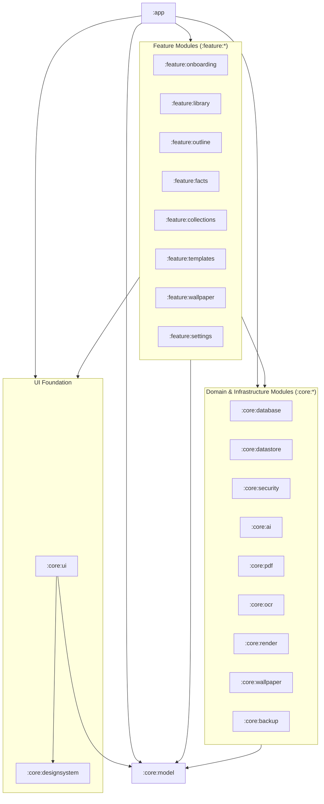

# Facts Wallpaper — Definitive End-to-End Architecture & Feature Specification

> **Document Version:** 2.0 (October 2026 SOTA Orchestrator Edition)  
> **Target Platform:** Android 13+ (`minSdk = 33`, `targetSdk = 36`, `compileSdk = 36`)  
> **Application ID:** `com.factswallpaper.app`  
> **Purpose:** Complete, zero-ambiguity product, architecture, data, AI pipeline, rendering, UI/UX, and verification specification designed to be executed end-to-end by an autonomous SOTA coding orchestrator and subagent team.

---

## Table of Contents

- [0. Orchestrator Execution Contract & Non-Negotiable Rules](#0-orchestrator-execution-contract--non-negotiable-rules)
- [1. Product Vision, Positioning & Core User Journey](#1-product-vision-positioning--core-user-journey)
- [2. Tech Stack, Build Config & 2026 Platform Targets](#2-tech-stack-build-config--2026-platform-targets)
- [3. Resolved Architectural Decisions (D1–D7)](#3-resolved-architectural-decisions-d1d7)
- [4. Complete Feature Specification (F1–F23)](#4-complete-feature-specification-f1f23)
- [5. Complete Data Model, Room Database & Persistence Contract](#5-complete-data-model-room-database--persistence-contract)
- [6. Complete AI Provider, Smart Routing & Prompt/Schema Contracts](#6-complete-ai-provider-smart-routing--promptschema-contracts)
- [7. Card Rendering Engine, Native JSON Template DSL & Offline Diagram Pipeline](#7-card-rendering-engine-native-json-template-dsl--offline-diagram-pipeline)
- [8. Live Wallpaper Service, Home/Lock Export & Rotation Engine](#8-live-wallpaper-service-homelock-export--rotation-engine)
- [9. Design System (`:core:designsystem` & `:core:ui`) & Screen-by-Screen UI Blueprint](#9-design-system-coredesignsystem--coreui--screen-by-screen-ui-blueprint)
- [10. Testing, Verification, CI/CD & Release Acceptance Matrix](#10-testing-verification-cicd--release-acceptance-matrix)
- [11. Cross-Cutting Rules, Platform Constraints & Edge Cases (Overrides Earlier Sections on Conflict)](#11-cross-cutting-rules-platform-constraints--edge-cases-overrides-earlier-sections-on-conflict)
- [Appendix A: Post-Mortem of v1 Prototype & Reusable Domain Logic](#appendix-a-post-mortem-of-v1-prototype--reusable-domain-logic)
- [Appendix B: Phased Vertical-Slice Build Order for Orchestrator Agents](#appendix-b-phased-vertical-slice-build-order-for-orchestrator-agents)

---

## 0. Orchestrator Execution Contract & Non-Negotiable Rules

> [!IMPORTANT]
> **100% Greenfield Build From Scratch:** This specification defines a **brand-new application to be generated completely from scratch** in a clean workspace. Do **NOT** patch, import, or depend on any legacy prototype files. Every module, entity, schema, prompt, and UI screen is specified self-contained in this document.

The first prototype of **Facts Wallpaper** failed because it was built horizontally with mock UI state, nullable default no-op callbacks, unimplemented core interfaces, missing Dependency Injection, and a rule that forbade local Gradle compilation. **When building this application from scratch, the orchestrator and all worker subagents MUST enforce the following 8 invariants:**

0. **Clean-Slate Greenfield Generation:**
   - Generate the entire 21-module project from scratch in a clean directory. Never assume any pre-existing source files exist.
1. **Real Local Builds & Gradle Wrapper First:**
   - Initialize and commit a working Gradle 8.11+ / 8.13 wrapper (`gradlew`, `gradlew.bat`, `gradle/wrapper/gradle-wrapper.jar`, `gradle-wrapper.properties`) in Phase 1.
   - Every vertical slice MUST compile (`./gradlew assembleDebug`) and pass unit tests (`./gradlew testDebugUnitTest`) before moving to the next phase.
2. **Mandatory Dependency Injection & Full Module Wiring:**
   - Use **Hilt** (`com.google.dagger.hilt.android`) or **Koin** across `:app`, `:feature:*`, and `:core:*`.
   - `:app` MUST depend on all `:feature:*` AND `:core:*` modules and wire real repository, DAO, datastore, keystore, AI client, PDF, OCR, render, backup, and wallpaper bindings into every `@HiltViewModel` / ViewModel.
3. **Zero Mock Data or Disabled Callbacks in Production Screens:**
   - Production `@Composable` screens MUST NEVER default to sample lists (`Biology 201 Lecture Notes.pdf`, etc.) or nullable callbacks (`onAction: (() -> Unit)? = null`) that render buttons disabled.
   - Sample data is permitted ONLY inside `@Preview` functions or `src/test` / `src/androidTest` fixtures.
   - Every screen must read from a real `StateFlow<UiState>` emitted by its ViewModel backed by Room and DataStore.
4. **All 11 Routes Wired in Navigation:**
   - All 11 screens (`onboarding`, `library`, `import_pdf`, `outline`, `facts`, `collections`, `template_gallery`, `card_preview`, `wallpaper_settings`, `provider_settings`, `advanced_settings`) must be registered in `AppRoute` and reachable in `AppNavHost` (no orphaned screens).
5. **No Interface-Only Core Modules:**
   - Every interface in `:core:pdf`, `:core:ocr`, `:core:render`, `:core:ai`, `:core:wallpaper`, and `:core:backup` MUST have a concrete, tested production implementation bound in the DI graph.
6. **Pre-Rendered Bitmap Invariant for Live Wallpaper:**
   - `FactsLiveWallpaperService` MUST NEVER invoke network calls, AI clients, PDF parsers, or `WebView` instances. It reads exclusively pre-rendered PNG bitmaps from `CardRenderCache` (with a lightweight `Canvas` text fallback if the cache is empty).
7. **October 2026 Model & SDK Standards:**
   - Target Android 16 (`compileSdk = 36`, `targetSdk = 36`, `minSdk = 33`).
   - Ship October 2026 SOTA provider presets (Google Gemini `gemini-3.8-flash` / `gemini-4-argon`, OpenAI `gpt-6.1-sol` / `gpt-6-luna` / `gpt-6-astra`, Anthropic `claude-sonnet-5-5` / `claude-haiku-5-5` / `claude-opus-5-5`, plus OpenRouter, DeepSeek, Qwen, Azure OpenAI, and custom OpenAI-compatible endpoints) while keeping model IDs 100% user-editable.

---

## 1. Product Vision, Positioning & Core User Journey

### 1.1 Product Vision
**Facts Wallpaper** is an Android 13+ study-utility application that transforms dense PDFs—textbooks, lecture slides, research papers, and scanned handwritten or printed notes—into **high-utility, glanceable study cards** displayed directly on the user's wallpaper. Every phone unlock or scheduled interval surfaces a new, bite-sized fact, scientific formula, or visual diagram from the user's active study material, turning passive screen checks into effortless spaced exposure.

### 1.2 Aesthetic & UX Direction: *"Scholar's Slate"*
- **Visual Persona:** Quiet, authoritative, distraction-free academic workspace inspired by Readwise Reader, Notion, and Linear.
- **Typography:** High-contrast editorial serif (`FontFamily.Serif` / Newsreader / Lora style) for display titles, headers, and quote cards, paired with crisp humanist sans-serif for dense body text and monospace for LaTeX/TikZ/Mermaid code and token/cost metrics.
- **Palette:** Warm alabaster paper (`#FAF8F5`) in Light mode, deep slate (`#0F1419`) in Dark mode, and true pitch-black (`#000000`) in AMOLED mode with clock-safe top margins so lock-screen and home-screen system widgets remain 100% legible.

### 1.3 End-to-End Core User Journey


---

## 2. Tech Stack, Build Config & 2026 Platform Targets

### 2.1 SDK & Language Baseline
| Property | Value | Rationale |
|---|---|---|
| `minSdk` | `33` (Android 13 / TIRAMISU) | Modern runtime permissions (`POST_NOTIFICATIONS`), granular media permissions, dynamic color, modern `KeyStore` guarantees. |
| `compileSdk` | `36` (Android 16) | Required for 2026 AndroidX libraries and `PdfRenderer` text APIs. |
| `targetSdk` | `36` (Android 16) | Google Play requirement as of August 31, 2026. |
| `Java / JVM Toolchain` | `17` | Standard for AGP 8.7+ / Kotlin 2.1+. |
| `Kotlin` | `2.1.10+` | K2 compiler, kotlinx.serialization, Coroutines/Flow. |
| `UI Framework` | Jetpack Compose (Material 3) | Declarative UI across all 11 screens + `ComposeView` / offscreen Canvas card rendering. |
| `Dependency Injection` | Hilt (`2.54+`) with KSP | Compile-time verified DI across multi-module Android app + `hilt-work` for WorkManager. |

### 2.2 Complete Version Catalog (`gradle/libs.versions.toml`)
The orchestrator must configure `gradle/libs.versions.toml` with the following dependencies. **The version numbers below are MINIMUM baselines, not pins.** At build time, bump every entry to the latest *stable* release that is mutually compatible, and verify:
- AGP must officially support `compileSdk = 36` (AGP **8.10+**; prefer the latest stable 8.x/9.x) with the Gradle version AGP requires.
- `ksp` version must match the Kotlin version exactly (`<kotlin>-<ksp>` scheme or KSP2 equivalent).
- Compose BOM should be the latest stable BOM (the `2025.02.00` value below is a floor).
- If any listed artifact cannot be resolved, pick the nearest stable version and record the change in `docs/DECISIONS.md` — never stall on a version number.

```toml
[versions]
agp = "8.8.0"
kotlin = "2.1.10"
ksp = "2.1.10-1.0.30"
hilt = "2.55"
hiltAndroidx = "1.2.0"
coroutines = "1.10.1"
serialization = "1.8.0"
composeBom = "2025.02.00"
activityCompose = "1.10.0"
navigationCompose = "2.8.7"
lifecycle = "2.8.7"
room = "2.7.0"
sqlcipher = "4.6.1"
sqliteKtx = "2.4.0"
datastore = "1.1.2"
work = "2.10.0"
ktor = "3.0.3"
okhttp = "4.12.0"
mlkitTextRecognition = "16.0.1"
pdfboxAndroid = "2.0.27.0"
webkit = "1.12.1"
zip4j = "2.11.5"
junit4 = "4.13.2"
robolectric = "4.14.1"
roborazzi = "1.39.0"
truth = "1.4.4"
turbine = "1.2.0"
androidxTestExt = "1.2.1"
espresso = "3.6.1"

[libraries]
# Core & Kotlin
kotlinx-coroutines-core = { module = "org.jetbrains.kotlinx:kotlinx-coroutines-core", version.ref = "coroutines" }
kotlinx-coroutines-android = { module = "org.jetbrains.kotlinx:kotlinx-coroutines-android", version.ref = "coroutines" }
kotlinx-coroutines-play-services = { module = "org.jetbrains.kotlinx:kotlinx-coroutines-play-services", version.ref = "coroutines" }
kotlinx-serialization-json = { module = "org.jetbrains.kotlinx:kotlinx-serialization-json", version.ref = "serialization" }

# Compose & UI
androidx-compose-bom = { module = "androidx.compose:compose-bom", version.ref = "composeBom" }
androidx-compose-ui = { module = "androidx.compose.ui:ui" }
androidx-compose-ui-graphics = { module = "androidx.compose.ui:ui-graphics" }
androidx-compose-ui-tooling = { module = "androidx.compose.ui:ui-tooling" }
androidx-compose-ui-tooling-preview = { module = "androidx.compose.ui:ui-tooling-preview" }
androidx-compose-foundation = { module = "androidx.compose.foundation:foundation" }
androidx-compose-material3 = { module = "androidx.compose.material3:material3" }
androidx-compose-material-icons-extended = { module = "androidx.compose.material:material-icons-extended" }
androidx-activity-compose = { module = "androidx.activity:activity-compose", version.ref = "activityCompose" }
androidx-navigation-compose = { module = "androidx.navigation:navigation-compose", version.ref = "navigationCompose" }
androidx-lifecycle-runtime-compose = { module = "androidx.lifecycle:lifecycle-runtime-compose", version.ref = "lifecycle" }
androidx-lifecycle-viewmodel-compose = { module = "androidx.lifecycle:lifecycle-viewmodel-compose", version.ref = "lifecycle" }

# Hilt DI
hilt-android = { module = "com.google.dagger:hilt-android", version.ref = "hilt" }
hilt-compiler = { module = "com.google.dagger:hilt-android-compiler", version.ref = "hilt" }
androidx-hilt-navigation-compose = { module = "androidx.hilt:hilt-navigation-compose", version.ref = "hiltAndroidx" }
androidx-hilt-work = { module = "androidx.hilt:hilt-work", version.ref = "hiltAndroidx" }
androidx-hilt-compiler = { module = "androidx.hilt:hilt-compiler", version.ref = "hiltAndroidx" }

# Persistence & Security
androidx-room-runtime = { module = "androidx.room:room-runtime", version.ref = "room" }
androidx-room-ktx = { module = "androidx.room:room-ktx", version.ref = "room" }
androidx-room-compiler = { module = "androidx.room:room-compiler", version.ref = "room" }
androidx-room-testing = { module = "androidx.room:room-testing", version.ref = "room" }
sqlcipher-android = { module = "net.zetetic:sqlcipher-android", version.ref = "sqlcipher" }
androidx-sqlite-ktx = { module = "androidx.sqlite:sqlite-ktx", version.ref = "sqliteKtx" }
androidx-datastore-preferences = { module = "androidx.datastore:datastore-preferences", version.ref = "datastore" }

# Background Work
androidx-work-runtime-ktx = { module = "androidx.work:work-runtime-ktx", version.ref = "work" }
androidx-work-testing = { module = "androidx.work:work-testing", version.ref = "work" }

# Networking
ktor-client-core = { module = "io.ktor:ktor-client-core", version.ref = "ktor" }
ktor-client-okhttp = { module = "io.ktor:ktor-client-okhttp", version.ref = "ktor" }
ktor-client-content-negotiation = { module = "io.ktor:ktor-client-content-negotiation", version.ref = "ktor" }
ktor-serialization-kotlinx-json = { module = "io.ktor:ktor-serialization-kotlinx-json", version.ref = "ktor" }
ktor-client-mock = { module = "io.ktor:ktor-client-mock", version.ref = "ktor" }
okhttp = { module = "com.squareup.okhttp3:okhttp", version.ref = "okhttp" }

# PDF, OCR, Rendering & Backup
mlkit-text-recognition = { module = "com.google.mlkit:text-recognition", version.ref = "mlkitTextRecognition" }
pdfbox-android = { module = "com.tom-roush:pdfbox-android", version.ref = "pdfboxAndroid" }
androidx-webkit = { module = "androidx.webkit:webkit", version.ref = "webkit" }
zip4j = { module = "net.lingala.zip4j:zip4j", version.ref = "zip4j" }

# Testing
junit4 = { module = "junit:junit", version.ref = "junit4" }
kotlinx-coroutines-test = { module = "org.jetbrains.kotlinx:kotlinx-coroutines-test", version.ref = "coroutines" }
google-truth = { module = "com.google.truth:truth", version.ref = "truth" }
turbine = { module = "app.cash.turbine:turbine", version.ref = "turbine" }
robolectric = { module = "org.robolectric:robolectric", version.ref = "robolectric" }
roborazzi = { module = "io.github.takahirom.roborazzi:roborazzi", version.ref = "roborazzi" }
roborazzi-compose = { module = "io.github.takahirom.roborazzi:roborazzi-compose", version.ref = "roborazzi" }
roborazzi-junit-rule = { module = "io.github.takahirom.roborazzi:roborazzi-junit-rule", version.ref = "roborazzi" }
androidx-compose-ui-test-junit4 = { module = "androidx.compose.ui:ui-test-junit4" }
androidx-compose-ui-test-manifest = { module = "androidx.compose.ui:ui-test-manifest" }
androidx-test-ext-junit = { module = "androidx.test.ext:junit", version.ref = "androidxTestExt" }
androidx-test-espresso-core = { module = "androidx.test.espresso:espresso-core", version.ref = "espresso" }

[plugins]
android-application = { id = "com.android.application", version.ref = "agp" }
android-library = { id = "com.android.library", version.ref = "agp" }
kotlin-android = { id = "org.jetbrains.kotlin.android", version.ref = "kotlin" }
kotlin-compose = { id = "org.jetbrains.kotlin.plugin.compose", version.ref = "kotlin" }
kotlin-serialization = { id = "org.jetbrains.kotlin.plugin.serialization", version.ref = "kotlin" }
ksp = { id = "com.google.devtools.ksp", version.ref = "ksp" }
hilt = { id = "com.google.dagger.hilt.android", version.ref = "hilt" }
roborazzi = { id = "io.github.takahirom.roborazzi", version.ref = "roborazzi" }
```

### 2.3 Multi-Module Architecture & Dependency Graph
The project uses 21 Gradle modules (`:app` + 8 `:feature:*` + `:core:model`, `:core:designsystem`, `:core:ui` + 9 domain `:core:*`). `ImportPdfScreen` lives in `:feature:library`; `:feature:wallpaper` hosts `WallpaperSettingsScreen`; `:feature:settings` hosts Provider + Advanced settings organized into 4 layers. Every `:feature:*` module MUST depend on `:core:model`, `:core:designsystem`, `:core:ui`, and the relevant `:core:*` domain modules (or a unified repository layer):



---

## 3. Resolved Architectural Decisions (D1–D7)

To eliminate ambiguity during autonomous execution, the 7 architectural gaps from the v1 prototype are resolved as follows:

| ID | Decision Area | Mandatory Resolution |
|---|---|---|
| **D1** | **Card Rasterization Pipeline** | **Dual-Stage Offline Renderer (`:core:render`)**: Standard cards (`TEXT`, `QUOTE`, `BULLET`, `DEFINITION`, `QA`, `TIMELINE`) are rendered offscreen to `Bitmap` using an offscreen Compose/Canvas rasterizer (`CardBitmapRenderer`) at the device's physical display pixel dimensions (`DisplayMetrics.widthPixels x heightPixels`). Formula (`FORMULA`) and Diagram (`DIAGRAM`) sub-regions are first rasterized to transparent/themed PNG bitmaps by `OfflineWebViewDiagramRenderer` (see **D2**), then composited into the card layout and written to `context.filesDir/rendered_cards/{cacheKey}.png`. |
| **D2** | **Offline LaTeX, Mermaid & TikZ Engine** | **Single-Threaded Offscreen `WebView` + `WebViewAssetLoader` (`:core:render`)**: Bundle minified `katex.min.js` + `katex.min.css` + fonts, `mermaid.min.js`, and `tikzjax.js` inside `:core:render/src/main/assets/renderer/`. Load via `https://appassets.androidplatform.net/assets/renderer/index.html` using `androidx.webkit.WebViewAssetLoader`. Enforce `webSettings.blockNetworkLoads = true`, `allowFileAccess = false`, `allowContentAccess = false`, `javaScriptEnabled = true`. Execute on `Dispatchers.Main` protected by a `Mutex` with a 10-second per-diagram timeout. Capture the rendered DOM node bounding box to a `Bitmap`. |
| **D3** | **PDF Text & Page Bitmap Extraction** | **Hybrid `PdfRenderer` + `PdfBox-Android` (`:core:pdf`)**: Initialize `PDFBoxResourceLoader.init(applicationContext)` at startup. For each page `1..pageCount`, extract text via `PDFTextStripper` (`setStartPage(p)`, `setEndPage(p)`). On Android 15+ (`SDK_INT >= 35` or Android 13/14 with `SdkExtensions.getExtensionVersion(Build.VERSION_CODES.R) >= 13`), `PdfRenderer.Page.getTextContents()` may be used as a fast primary path with `PdfBox-Android` fallback. For scanned pages requiring OCR, open `android.graphics.pdf.PdfRenderer(ParcelFileDescriptor)` and render page `p - 1` at `scale = 2.0f` (~144–200 DPI, capped at max 2400px longest edge) into `Bitmap.Config.ARGB_8888`, wrapped in `OcrPageImage` (`Closeable`) and recycled immediately after ML Kit completes. |
| **D4** | **Encrypted Database Mode** | **Dynamic SQLCipher Toggle (`:core:database` + `:core:security`)**: Store a 256-bit random DB passphrase encrypted inside `AndroidKeystoreApiKeyStore` under reserved key `__sqlcipher_db_passphrase__`. When `encryptedDatabaseEnabled == false` (default), open `FactsDatabase` with standard framework SQLite. When the user toggles **Encrypted Database Mode** in Advanced Settings, run `DatabaseEncryptionMigrator` (exports plaintext DB via `sqlcipher_export` into an encrypted SQLCipher file using `net.zetetic.database.sqlcipher.SupportOpenHelperFactory(passphraseBytes)`, swaps files atomically, and reinitializes the Room singleton). |
| **D5** | **AI Task JSON Schemas & Prompt Templates** | **All 6 Tasks Specified Verbatim**: Section 6.6 defines exact JSON schemas and system/user prompt templates for `OUTLINE`, `FACTS`, `JSON_REPAIR`, `FORMULA_VERIFICATION`, `DIAGRAM_GENERATION`, and `TEMPLATE_GENERATION`, plus fact regeneration and AI collection curation. |
| **D6** | **Native JSON Template Schema (`NATIVE_JSON`)** | **Formal `CardTemplateSpec` JSON DSL**: Section 7.1 defines the exact `@Serializable` `CardTemplateSpec` data structure used by all 8 built-in templates and by `AiTask.TEMPLATE_GENERATION`. |
| **D7** | **Missing Room Entities & DAOs** | **All 17 Room Entities Specified**: Section 5.2 defines the original entities plus the previously missing ones (`DocumentSettingsEntity`, `DocumentChunkEntity`, `UsageLedgerEntity`, `AiRequestLogEntity`, `UserFolderEntity` + `FolderFactCrossRef` + `FactTagEntity`) and their DAOs. |

---

## 4. Complete Feature Specification (F1–F23)

### F1. First-Launch Onboarding & Guided Setup (`:feature:onboarding`)
- **Purpose:** Guide first-time users from install to their first active study wallpaper in 5 structured steps without requiring a login or cloud account.
- **Step Flow (5 Steps shown via `StepProgressHeader` + `OnboardingScreen`):**
  1. **Welcome & Value Proposition:** Editorial hero card previewing a live study card on a mock lock screen, explaining the workflow (*Import PDF → Extract Lessons & Facts → Auto-Rotate on Wallpaper*).
  2. **AI Provider & API Key Setup (BYOK):** Preset selector (`Google Gemini`, `OpenAI`, `Anthropic`, `OpenRouter`, `DeepSeek`, `Qwen`, `Azure OpenAI`, `Custom OpenAI-Compatible`), model picker (pre-filled with October 2026 SOTA defaults), password-masked API key input, **"Test Connection"** button (executes a lightweight live validation call and shows latency/status badge), and Keystore encryption confirmation badge.
  3. **Import First Study PDF:** Quick-action buttons for **Choose Local PDF** (launches SAF `ActivityResultContracts.OpenDocument` for `application/pdf` with `takePersistableUriPermission`) or **Import from HTTPS URL**, plus a **"Skip for now (Explore Library)"** secondary action.
  4. **Choose Card Style & Theme:** Quick preview selector for Theme Mode (`Light`, `Dark`, `AMOLED`, `Dynamic`) and default Built-In Template (`Minimal Text`, `Midnight AMOLED`, `Formula Spotlight`, etc.).
  5. **Activate Wallpaper:** Action button to open Android's system Live Wallpaper chooser (`WallpaperManager.ACTION_CHANGE_LIVE_WALLPAPER` targeting `FactsLiveWallpaperService`) or configure static Home/Lock screen export, plus a **"Finish Setup"** button that writes `onboardingCompleted = true` in `AppPreferencesDataStore` and navigates to `library` (popping `onboarding` off the back stack).

### F2. Multi-Source PDF Import (`:feature:library` & `:core:pdf`)
- **Local File Import (SAF):**
  - Uses Android Storage Access Framework (`Intent.ACTION_OPEN_DOCUMENT`, MIME `application/pdf`).
  - Calls `contentResolver.takePersistableUriPermission(uri, Intent.FLAG_GRANT_READ_URI_PERMISSION)`.
  - Computes SHA-256 content hash (`fileHash`) while streaming the PDF into app-private storage (`context.filesDir/pdfs/{docId}.pdf`) or reading via `ContentResolver` so the file remains accessible even if the user moves the original download.
- **Direct HTTPS URL Import (`PdfUrlDownloader`):**
  - Enforces strict security rules before and during download:
    1. **HTTPS-only:** Rejects `http://`, `file://`, `content://`, `ftp://` (`IllegalArgumentException("Only HTTPS URLs are allowed")`).
    2. **Content-Type / Magic-Byte Validation:** Accepts `application/pdf`, `application/x-pdf`, or `application/octet-stream` (verified by checking the `%PDF-` 5-byte magic header on the downloaded stream).
    3. **Hard Size Cap:** `maxBytes = 100L * 1024L * 1024L` (100 MB). Rejects both declared `Content-Length > 100 MB` and streaming reads exceeding `100 MB + 1 byte`, deleting the partial temp file immediately.
- **Duplicate Handling (`DuplicateHashDetector`):**
  - Before inserting a new `PdfDocumentEntity`, queries `PdfDocumentDao.findByHash(sha256)`.
  - If a match exists, displays a modal confirmation sheet offering:
    - **Open Existing Document** (navigates directly to the existing document's Outline or Facts).
    - **Re-Import & Replace** (re-runs analysis/extraction while optionally preserving starred/edited facts).
    - **Import as Copy** (creates a distinct `docId`).

### F3. PDF Inspection, Processing Route Classification & Cost Preview (`:core:pdf`)
- **Inspection Metadata (`PdfMetadata`):**
  - Extracts `title` (from PDF metadata dictionary or filename fallback), `pageCount`, `pagesWithExtractableText` (count of pages where extracted non-whitespace text length `>= 40` characters), `fileSizeBytes`, and `sha256Hash`.
- **Deterministic Route Classifier (`PdfAnalyzer.classify`):**
  ```kotlin
  enum class PdfProcessingRoute {
      DIRECT_PDF,             // User chose direct PDF upload and active provider supports directPdfInput
      EXTRACT_TEXT,           // All pages have extractable text (pagesWithText == pageCount)
      LOCAL_OCR,              // Scanned/hybrid PDF with (pageCount - pagesWithText) <= ocrLimitPages (default 20)
      OCR_REQUIRES_OVERRIDE   // Scanned/hybrid PDF with (pageCount - pagesWithText) > ocrLimitPages
  }
  ```
- **Pre-Processing Cost & Token Preview Card (`CostEstimateCard`):**
  - Displayed on `ImportPdfScreen` immediately after file inspection:
    - Shows total pages, text-layer pages vs scanned pages, estimated input tokens, estimated output tokens, and estimated USD cost (`$0.0042` format) based on the selected provider profile's pricing table.
    - Allows the user to toggle between **Local Text / OCR + AI** vs **Direct PDF Upload to AI** (enabled only if `profile.capabilities.directPdfInput == true`).

### F4. Local Text Extraction & Page-Range Filtering (`:core:pdf`)
- **Page-by-Page Text Extraction (`PdfTextExtractorImpl`):**
  - Extracts text per page (`1..pageCount`) and stores per-page character counts and raw text in `DocumentChunkEntity` / page map.
  - Preserves page numbers (`sourcePage`) so every generated lesson and fact links back to its exact source page.
- **Optional Page Range Filter:**
  - On `ImportPdfScreen`, users can specify an optional page range (e.g., `Pages 12–48` or `All Pages`) before running OCR or AI outline detection, avoiding wasted tokens on tables of contents, bibliographies, or appendices.

### F5. Page-by-Page Checkpointed Local OCR System, Best English & Downloadable Multilingual Models, and Compiled `.txt` LLM Upload (`:core:ocr`)

- **User-Selectable Local OCR Mode ("Full Local Page-by-Page OCR → Upload Text to LLM"):**
  - On `ImportPdfScreen`, the user can explicitly choose **"Local Page-by-Page OCR (On-Device)"** for any PDF (whether scanned, hybrid, or even digital PDFs with broken font encodings).
  - Instead of uploading heavy page images or raw PDFs to an expensive vision LLM, the phone rasterizes each page locally, runs on-device OCR page-by-page, compiles a clean page-indexed `.txt` file (`filesDir/ocr_text/{docId}.txt`), and uploads/sends that compiled text file to the LLM after OCR finishes.

- **Best Local English Model Out-of-the-Box + Optional Downloadable Multilingual Models (`OcrModelManager`):**
  1. **Bundled / Default High-Accuracy English OCR:**
     - Ships ready out-of-the-box with **Google ML Kit Text Recognition v2 (Latin/English high-accuracy recognizer)** (`com.google.mlkit:text-recognition`) plus **PP-OCRv4 / Tesseract 5 LSTM Best English (`eng.traineddata` / ONNX int8)** support so English textbooks, lecture slides, and dense academic pages work offline at maximum accuracy immediately after install.
  2. **On-Demand Downloadable Multilingual Models (`OcrLanguagePackEntity`):**
     - In `ImportPdfScreen` (via a **Language Model Selector** chip) and in `AdvancedSettingsScreen` (**"Local OCR Language Models"** manager), the user can download, verify, and delete optional offline language packs:
       - **Latin / European Languages** (Bundled — English, French, German, Spanish, Turkish, etc.)
       - **Arabic (`ara`)** — Downloadable high-accuracy LSTM / PP-OCRv4 pack (`~15 MB`, SHA-256 verified)
       - **Chinese (`zho` — Simplified & Traditional)** — ML Kit Chinese recognizer / PP-OCRv4 (`~18 MB`)
       - **Japanese (`jpn`)** — ML Kit Japanese recognizer / LSTM pack (`~18 MB`)
       - **Korean (`kor`)** — ML Kit Korean recognizer / LSTM pack (`~16 MB`)
       - **Devanagari / Hindi (`hin` / `san`)** — ML Kit Devanagari recognizer (`~14 MB`)
       - **Cyrillic / Russian (`rus` / `ukr`)** — Downloadable LSTM / PP-OCRv4 pack (`~15 MB`)
     - Each downloadable pack is stored in `context.noBackupFilesDir/ocr_models/{langCode}/`, shows live download progress (`0%..100%`), verifies SHA-256 checksum before activation, and works 100% offline once downloaded.

- **Page-by-Page Checkpointed Execution & Exact Crash/Cutoff Resume ("Restart the Interrupted Page"):**
  - **How Page-by-Page Checkpointing Works:**
    1. For each page `p` in `pageRangeStart..pageRangeEnd`:
       - **Step A (Mark Page Started):** Before rendering or OCRing page `p`, write `ocrLastStartedPage = p` and `extractionStatus = "OCR_IN_PROGRESS"` to `PdfDocumentEntity` in Room (and mark any existing `DocumentChunkEntity(docId, p)` as `status = "IN_PROGRESS"`).
       - **Step B (Rasterize Single Page):** Render page `p` via `PdfRenderer` at `scale = 2.5f` (~180–220 DPI, capped at `2560px` longest edge) into a single `OcrPageImage` (`Closeable` wrapping `Bitmap.Config.ARGB_8888`).
       - **Step C (Run Local OCR Model):** Run the selected local OCR model (English default or chosen multilingual model) on page `p`'s bitmap inside a `use { ... }` block that immediately calls `bitmap.recycle()` upon completion.
       - **Step D (Atomic Per-Page Commit):** Inside a single Room `@Transaction`, upsert `DocumentChunkEntity(documentId = docId, pageNumber = p, extractedText = pageText, status = "COMPLETED", isFromOcr = true, ocrConfidence = conf)` **AND** update `PdfDocumentEntity.ocrLastCompletedPage = p`.
    2. **Exact Cutoff / Interruption Recovery Rule (Example: Cutoff at Page 89):**
       - If the app is force-closed, killed by the OS, runs out of battery, or is paused/cut off while processing page `89` (so `ocrLastCompletedPage == 88` and `ocrLastStartedPage == 89`):
       - When the user (or WorkManager) resumes the OCR job, the pipeline inspects `PdfDocumentEntity`:
         ```kotlin
         val resumeFromPage = when {
             doc.ocrLastCompletedPage < settings.pageRangeStart -> settings.pageRangeStart
             doc.ocrLastStartedPage > doc.ocrLastCompletedPage -> doc.ocrLastStartedPage // e.g., Page 89 was cut off mid-page -> RESTART Page 89 from scratch!
             else -> doc.ocrLastCompletedPage + 1
         }
         ```
       - **Mandatory Restart of Stopped Page:** Page `89` is re-rasterized and re-OCRed from the very beginning of page `89`, overwriting any partial state for page `89`, and then continues `89, 90, 91, ...` through `pageRangeEnd`. Pages `1..88` are already committed in `DocumentChunkEntity` with `status = "COMPLETED"` and are **never** re-OCRed.
    3. **UI Resume Banner & Controls:**
       - Any document with `extractionStatus == "OCR_IN_PROGRESS"` or `extractionStatus == "OCR_PAUSED"` displays a prominent progress card on both `LibraryScreen` and `ImportPdfScreen`:
         `"Local OCR paused at Page 89 of 240 (Pages 1–88 saved) — [Resume from Page 89]"` alongside a `[Pause]` button while running.

- **Compiled `.txt` File Assembly & Upload to LLM After OCR Finishes:**
  - The moment `ocrLastCompletedPage == pageRangeEnd` (all target pages have `status == "COMPLETED"`):
    1. `OcrTextFileCompiler` queries all `DocumentChunkEntity` rows for `documentId` ordered by `pageNumber ASC` and writes a single UTF-8 plain-text file to `context.filesDir/ocr_text/{documentId}.txt` with deterministic page headers:
       ```text
       # Document: {title}
       # Pages: {pageRangeStart} to {pageRangeEnd}
       # OCR Model: {ocrEngine} ({languageCode})

       --- [PAGE 1] ---
       {page 1 full OCR text}

       --- [PAGE 2] ---
       {page 2 full OCR text}
       ...
       ```
    2. Persists `compiledOcrTextPath = "filesDir/ocr_text/{documentId}.txt"` and sets `extractionStatus = "OCR_DONE"` on `PdfDocumentEntity`.
    3. **LLM Handoff:** Once `OCR_DONE` is reached, the pipeline automatically (or on user tap) uploads/sends the compiled `.txt` file content to the LLM (`AiTask.OUTLINE` and subsequently `AiTask.FACTS` via `TextChunker` if the `.txt` exceeds a single context window). Users can also view or export the generated `.txt` file from the document menu.

- **20-Page Advisory Warning (Non-Blocking for Resumable Local OCR):**
  - Because local OCR is checkpointed page-by-page and resumable at any time, there is **no hard page ceiling**; for PDFs with `> 20` pages to OCR, the UI shows an estimated duration badge (e.g., `"~1.5 sec/page · runs in background & saves after every page"`) and defaults `OcrExecutionMode` to `BACKGROUND` (`OcrProcessingWorker` foreground service with live page notification `"OCRing Page 89 of 240 — Pause / Cancel"`).

### F6. AI Outline & Lesson Structure Detection (`:feature:outline` & `:core:ai`)
- **Automated Hierarchical Outline Extraction:**
  - Sends extracted/OCR text (or direct PDF) to `AiTask.OUTLINE`.
  - Returns a structured list of chapters/units and lessons (`OutlineLesson`) with `title`, `summary`, `startPage`, `endPage`, and `sortOrder`.
- **Interactive Lesson Curation (`OutlineScreen`):**
  - Users can:
    - **Select All / Deselect All** lessons or toggle individual lessons via `LessonSelectionRow`.
    - **Inline Edit** any lesson's title, summary, or `startPage..endPage` range via an edit bottom sheet.
    - **Merge Selected Lessons** (combines 2+ adjacent lessons into a single lesson spanning `min(startPage)..max(endPage)`).
    - **Split Lesson** (splits a lesson at a chosen page boundary into two lessons).
    - **Add Manual Lesson** or **Delete Lesson**.
- **Per-Lesson Density & Content Controls:**
  - Before tapping **"Generate Facts for Selected Lessons (N)"**, the user can set:
    - **Fact Density:** `CONCISE` (3–5 facts/lesson), `BALANCED` (6–10 facts/lesson), `DEEP` (12–18 facts/lesson).
    - **Extraction Toggles:** `Include LaTeX Formulas`, `Include Visual Diagrams`, `Auto-Verify Formulas`.

### F7. AI Fact, Formula & Diagram Extraction (`:feature:facts` & `:core:ai`)
- **Structured Fact Extraction (`AiTask.FACTS`):**
  - For each selected lesson, extracts self-contained, high-retention study facts (`FactItemEntity`) strictly adhering to `FactsJsonSchema`:
    - `text`: Concise, standalone statement (80–280 characters ideal for lock-screen legibility).
    - `latex`: Optional valid KaTeX string (e.g., `\nabla \times \mathbf{E} = -\frac{\partial \mathbf{B}}{\partial t}`).
    - `requiresLatex`: Boolean flag.
    - `templateType`: Recommended card archetype (`TEXT`, `QUOTE`, `BULLET`, `DEFINITION`, `QA`, `FORMULA`, `DIAGRAM`, `TIMELINE`).
    - `diagramType`: `NONE`, `MERMAID`, `TIKZ`, `SVG`, or `HTML_CANVAS`.
    - `sourceLessonTitle` and `sourcePage`.
    - `tags`: 1–4 topical tags (e.g., `["thermodynamics", "entropy", "exam-1"]`).
    - `confidence`: Float `0.0..1.0`.
- **Semantic Page/Paragraph Chunking for Large Lessons (`TextChunker`):**
  - When a lesson's text exceeds the active model's safe input budget (e.g., `> 60%` of `maxContextTokens`), `TextChunker` splits the lesson along page and paragraph boundaries (`\n\n`) with a 1-paragraph overlap, dispatches chunk requests sequentially or with bounded concurrency (`maxConcurrency = 2`), and deduplicates merged facts by normalized Levenshtein/cosine token similarity (`> 0.85`).
- **Automatic Malformed JSON Repair (`JsonRepairService`):**
  - If the model returns markdown-fenced or slightly malformed JSON that fails `kotlinx.serialization` parsing + `SchemaValidator`, the pipeline runs **at most 1 repair pass** (`AiTask.JSON_REPAIR`) at `temperature = 0.0`. If the repair pass still fails validation, the error is logged to `AiRequestLogEntity` and surfaced cleanly without silent data corruption.

### F8. Scientific Formula Rendering & Two-Tier Verification (`:core:render` & `:core:ai`)
- **Offline KaTeX Rendering:**
  - All formulas (`requiresLatex == true` or `templateType == FORMULA`) are rendered offline via bundled KaTeX inside `OfflineWebViewDiagramRenderer`.
- **Two-Tier Formula & Diagram Verification (`DiagramVerificationService`):**
  1. **Tier 1 — Deterministic Local Sanitizer (`DiagramValidator`):** Decodes HTML entities, strips control characters, validates balanced braces/delimiters in LaTeX, and rejects any script/event-handler payloads.
  2. **Tier 2 — Low-Token AI Verification (`AiTask.FORMULA_VERIFICATION`):** When `autoVerifyFormulas == true`, sends the formula/diagram source to a fast model at `temperature = 0.0`, `maxOutputTokens = 128`, schema `{"valid": boolean}`.
  - Only formulas/diagrams passing both checks are marked `verificationStatus = VERIFIED`; failed items fall back to clean plain-text card rendering (`TEXT` template) and display a `"Needs Review"` badge in `FactsScreen`.

### F9. Offline Diagram Generation & Sandbox Rendering (`:core:render` & `:core:ai`)
- **Supported Diagram Formats (`DiagramKind`):**
  - `MERMAID` (flowcharts, sequence diagrams, state diagrams, class diagrams, ER diagrams, mindmaps).
  - `TIKZ` (physics free-body diagrams, chemical structures, commutative diagrams, geometry via bundled TikZJax WASM).
  - `SVG` (sanitized vector diagrams).
  - `HTML_CANVAS` (self-contained HTML/CSS visual layouts with zero external network assets).
- **Security Sandbox (`DiagramValidator`):**
  - Strips null bytes and whitespace, decodes hex (`&#x...;`), decimal (`&#...;`), and named (`&colon;`, `&tab;`, `&newline;`) entities, and rejects `<script`, `javascript:`, `<iframe`, `<object`, `<embed`, and any `on[a-z]+=` attribute before the markup ever reaches the offline `WebView`.
- **Cached PNG Output:**
  - Rendered diagram bitmaps are saved as content-addressed PNGs (`DiagramAssetEntity`) so the wallpaper service never touches `WebView`.

### F10. Fact Review, Inline Editing, AI Regeneration & Provenance (`:feature:facts`)
- **Comprehensive Fact Management (`FactsScreen`):**
  - Filter facts by **Document**, **Lesson**, **Search Query** (full-text match on `text`, `latex`, `tags`), **Status Filter** (`All`, `Active`, `Ignored`, `Favorites`, `Formulas`, `Diagrams`), and **Tag Chips**.
- **Per-Fact Actions (`FactListItemCard` & Edit Sheet):**
  - **Active/Ignore Toggle (`active`):** Includes or excludes the fact from wallpaper rotation.
  - **Favorite / Star Toggle (`favorite`):** Marks high-priority facts for the Favorites collection or priority rotation.
  - **Inline Edit Sheet:** Edit `text`, `latex`, `templateType`, `diagramType`, `diagramSource`, `tags`, and `sourcePage` with a live mini card preview.
  - **AI Regenerate Fact:**
    - *One-Tap Regenerate:* Re-prompts the AI using the original source page text to write a clearer/sharper version.
    - *Guided Regenerate:* User enters custom instructions (e.g., *"Convert this into a Q&A flashcard"*, *"Include the exact Maxwell equation in LaTeX"*, *"Make it shorter than 120 characters"*).
  - **Provenance Badge:** Every fact displays its origin (`Book Title · Lesson Name · Page 42`) and can toggle how provenance is shown on the wallpaper card (`FULL`, `COMPACT`, `PAGE_ONLY`, `HIDDEN`).

### F11. Collections, Folders, Tags & Rotation Pool Builder (`:feature:collections`)
- **4 Organization Layers:**
  1. **Smart Built-In Views:** `All Active Facts`, `Starred / Favorites`, `Formulas & Equations`, `Visual Diagrams`, `Recently Added`.
  2. **User Folders (`UserFolderEntity`):** User-created named folders (e.g., *"Midterm Exam Prep"*, *"memorize before Friday"*) containing manually assigned facts or documents.
  3. **Topical Tags (`FactTagEntity`):** Multi-tag filtering across one or multiple PDFs.
  4. **AI-Suggested Collections (`CollectionEntity` with `source = AI_SUGGESTED`):** One-tap **"Generate Smart Collections"** button sends active fact summaries/tags to the AI to group cross-chapter concepts into cohesive study decks (e.g., *"Cell Signalling Pathways"*, *"Key Organic Reaction Mechanisms"*), which the user can **Accept**, **Rename**, or **Dismiss**.
- **Active Wallpaper Rotation Pool (`RotationPoolResolver`):**
  - Users can toggle any combination of Documents, Lessons, Collections, Folders, or Starred status into the **Active Wallpaper Pool**.
  - A live counter pill at the top of `CollectionsScreen` and `WallpaperSettingsScreen` shows `"Active Pool: 84 Facts across 3 Collections"` and warns if the resolved pool is empty (`0 facts`).

### F12. Built-In Card Template Gallery (`:feature:templates` & `:core:render`)
- **8 Built-In Templates (`BuiltInTemplates`):**
  1. `builtin_minimal_text` (**Minimal Text**): Clean centered typography with generous margins and subtle top category pill.
  2. `builtin_split_header` (**Split Header**): Accent-tinted top header band with lesson/book metadata and high-contrast body below.
  3. `builtin_quote_highlight` (**Quote Highlight**): Oversized decorative editorial serif quotation mark, italic serif body, bottom attribution bar.
  4. `builtin_formula_spotlight` (**Formula Spotlight**): Framed surface-container math stage centering the rendered KaTeX equation with explanatory caption below.
  5. `builtin_diagram_card` (**Diagram Card**): Upper 55% dedicated to the rendered Mermaid/TikZ/SVG diagram container, lower 45% concise takeaway + page badge.
  6. `builtin_compact_bullet` (**Compact Bullet**): Structured multi-bullet breakdown (`•` points parsed from newline/semicolon segments) for multi-part facts.
  7. `builtin_midnight_amoled` (**Midnight AMOLED**): Pure `#000000` background with >85% black pixel ratio, muted slate border (`#1A222B`), and soft off-white text (`#E2E8F0`) engineered specifically for OLED power saving and zero night-time glare.
  8. `builtin_neon_study` (**Neon Study Card**): Deep charcoal background (`#0B0F17`) with vibrant cyan/amber accent glow pills and crisp monospace metadata.

### F13. Custom & AI-Generated Card Templates (`:feature:templates`)
- **Visual Template Customizer:**
  - Users can duplicate any built-in template and customize:
    - Font family (`Serif`, `Sans`, `Monospace`), font scale (`0.8x` to `1.4x`), text alignment (`START`, `CENTER`).
    - Card padding, corner radius, border width, background style (`SOLID`, `GRADIENT`, `AMOLED_BLACK`), and accent color role.
    - Metadata footer mode (`FULL`, `COMPACT`, `PAGE_ONLY`, `HIDDEN`).
- **AI Template Generator (`AiTask.TEMPLATE_GENERATION`):**
  - Users describe a desired aesthetic in plain English (e.g., *"Warm vintage parchment card with large serif header and compact page number at the bottom right"*) and the AI generates a validated `CardTemplateSpec` (`NATIVE_JSON`) or sandboxed `HTML_CANVAS` template, renders a live preview on `CardPreviewScreen`, and lets the user save it to `TemplateEntity`.

### F14. Content-Addressed Render Cache & Pre-Rendering Engine (`:core:render`)
- **Deterministic Cache Key (`RenderCacheKey`):**
  - Computes SHA-256 over length-prefixed (`"${v.length}:$v"`) fields: `factId`, `templateId`, `templateVersion`, `contentHashInput` (hash of `text + latex + diagramSource`), `width`, `height`, `targetSurface` (`HOME`, `LOCK`, `BOTH`, `LIVE`), `themeKey` (`LIGHT`, `DARK`, `AMOLED`, `DYNAMIC`), `renderEngineVersion`, and `sourceReferenceMode`.
- **Proactive Pre-Render Queue (`CardPreRenderWorker`):**
  - Whenever facts are added to the active rotation pool or template/theme settings change, a background coroutine / `WorkManager` job pre-renders the next `N` cards (default `25`) in the rotation queue so wallpaper transitions are instantaneous (`< 16ms` bitmap read).
- **Last-Known-Good Fallback (`CardRenderCache.getLastKnownGood`):**
  - Always pins the most recently verified rendered PNG so the wallpaper is guaranteed never to render a blank black screen.

### F15. Live Wallpaper Engine & Static Wallpaper Export (`:core:wallpaper` & `:feature:wallpaper`)
- **Primary Mode: Android `WallpaperService` (`FactsLiveWallpaperService`):**
  - Registers `<service android:name="com.factswallpaper.core.wallpaper.FactsLiveWallpaperService" android:permission="android.permission.BIND_WALLPAPER" android:exported="true">` with `<meta-data android:name="android.service.wallpaper" android:resource="@xml/facts_wallpaper" />`.
  - Draws pre-rendered card bitmaps onto `SurfaceHolder` with configurable top clock-safe inset (`18%`–`32%` of screen height, default `24%`) and bottom gesture-bar inset (`8%`).
- **Secondary Mode: Static `WallpaperManager` Export (`StaticWallpaperExporter`):**
  - For users who prefer static system wallpapers or OEM lock screens that restrict live wallpapers on the lock screen:
    - Applies the current rendered card bitmap directly via `WallpaperManager.getInstance(context).setBitmap(bitmap, null, true, flags)` where `flags` is `FLAG_SYSTEM` (Home), `FLAG_LOCK` (Lock), or `FLAG_SYSTEM or FLAG_LOCK` (Both).
    - Can also be scheduled via `WorkManager` periodic jobs (`>= 15 min` interval) to update the system/lock static wallpaper automatically.

### F16. Flexible Wallpaper Rotation Engine (`:core:wallpaper`)
- **3 Trigger Modes (`WallpaperScheduleMode`):**
  1. **`ON_UNLOCK` (Default):** Inside `FactsLiveWallpaperService.Engine`, registers a runtime `BroadcastReceiver` for `Intent.ACTION_USER_PRESENT` (device unlocked) and `Intent.ACTION_SCREEN_OFF` (with optional cooldown `minUnlockIntervalSeconds = 15` so rapid lock/unlock checks don't skip unread cards).
  2. **`INTERVAL`:** Advances the card every `intervalMinutes` (user configurable: `5m`, `15m`, `30m`, `1h`, `2h`, `4h`, `6h`, `12h`, `24h`) using an internal Handler/Coroutine timer when visible plus `WorkManager` backup.
  3. **`MANUAL`:** Rotates only when the user taps **"Next Card Now"** in the app, taps the Quick Settings Tile / App Shortcut, or (optionally) double-taps empty space on the live wallpaper (`enableDoubleTapToAdvance` toggle, default `false` to prevent accidental skips).
- **2 Ordering Modes (`RotationOrder`):**
  - **`SEQUENTIAL`:** Iterates through the active pool in lesson/fact order using `RotationReducer` (`nextIndex = (currentIndex + 1) % activeFactIds.size`).
  - **`RANDOM` (Shuffle without Immediate Repeat):** Uses a seeded Fisher-Yates cycle so every fact in the pool is shown once before reshuffling, guaranteeing no back-to-back repeats.

### F17. Universal Multi-Provider AI Architecture (`:core:ai` & `:feature:settings`)
- **8 First-Class Provider Types (`ProviderType`):**
  1. `GEMINI` (Google Gemini native `v1beta` & OpenAI-compatible)
  2. `OPENAI` (OpenAI `v1/responses` & `v1/chat/completions`)
  3. `ANTHROPIC` (Anthropic `v1/messages`)
  4. `AZURE_OPENAI` (Azure OpenAI resource + deployment + `api-version`)
  5. `OPENROUTER` (`https://openrouter.ai/api/v1`)
  6. `DEEPSEEK` (`https://api.deepseek.com/v1`)
  7. `QWEN` (`https://dashscope.aliyuncs.com/compatible-mode/v1`)
  8. `OPENAI_COMPATIBLE` (Custom base URL + custom headers + manual capability switches)
- **Multiple Saved Profiles (`ProviderProfileEntity`):**
  - Users can save multiple profiles (e.g., *"Gemini 3.8 Flash (Fast)"*, *"Gemini 4 Argon (Deep Math)"*, *"Claude Sonnet 5.5"*, *"Local Ollama / vLLM via Tailscale"*), test each connection, and assign task-specific overrides.

### F18. Capability-Aware Smart AI Router (`:core:ai`)
- **Automatic Task-to-Profile Routing (`AiRouter`):**
  - Evaluates all enabled `ProviderProfile`s with configured API keys that satisfy the `AiTask`'s required capabilities (`jsonSchema` for `OUTLINE`/`FACTS`/`JSON_REPAIR`/`FORMULA_VERIFICATION`, `directPdfInput` when `requireDirectPdf == true`).
  - Ranks candidates according to the selected `RoutingStrategy`:
    - `CHEAPEST`: Minimizes estimated cost (`inputPricePer1M + outputPricePer1M`).
    - `BALANCED` (Default): Balances capability score (structured JSON + context window + speed tier) against token cost.
    - `HIGHEST_QUALITY`: Prioritizes flagship reasoning models (`gemini-4-argon`, `claude-opus-5-5`, `gpt-6-astra`) for complex formula/diagram extraction and verification.
    - `MANUAL`: Always uses the user's explicitly pinned profile for that task (`TaskProfileOverride`).

### F19. Local Token Usage & Cost Estimation Ledger (`:core:ai` & `:core:database`)
- **Pre-Flight Cost Estimator (`CostEstimator`):**
  - Before executing an AI task, estimates input tokens (`ceil(charCount / 4.0)` for text or `pageCount * 300` for PDF pages) and expected output tokens, displaying estimated USD cost (`estimateCostUsd`).
- **Post-Flight Usage Ledger (`UsageLedgerEntity`):**
  - Every completed `AiClient` call parses exact token usage from the provider response (`inputTokens`, `outputTokens`), computes actual cost from the profile's per-million token rates (`inputUsdPerMillion`, `outputUsdPerMillion`), and records a row in `UsageLedgerEntity` linked to `providerProfileId`, `documentId`, `taskType`, `modelName`, and `timestampEpochMs`.
- **Settings Cost Dashboard:**
  - `ProviderSettingsScreen` and `AdvancedSettingsScreen` display cumulative tokens and USD spend broken down by **Today**, **Last 30 Days**, **All Time**, **By Provider Profile**, and **By PDF Document**.

### F20. Theme System & Display Adaptation (`:core:designsystem`)
- **4 Theme Modes (`ThemeMode`):**
  - `LIGHT`: Warm alabaster paper (`#FAF8F5`) with deep ink (`#181C20`) and academic teal primary (`#006684`).
  - `DARK`: Deep slate (`#0F1419`) with soft off-white (`#E1E2E8`) and sky cyan primary (`#76D1FF`).
  - `AMOLED`: True `#000000` background and `#090D12` elevated surfaces for zero OLED backlight bleed.
  - `DYNAMIC`: Material You (`dynamicLightColorScheme` / `dynamicDarkColorScheme` on Android 13+) blended with semantic `LocalFactColors`.
- **Independent App vs Wallpaper Theme:**
  - Users can set the in-app UI theme independently of the rendered wallpaper card theme (e.g., `LIGHT` in-app for daytime reading while forcing `AMOLED` on the wallpaper at all times).

### F21. Encrypted Local Backup & Restore (`:core:backup` & `:feature:settings`)
- **AES-256 Encrypted Archive (`BackupManager`):**
  - Exports a single `.fwbk` (ZIP) archive encrypted with Zip4j `AesKeyStrength.KEY_STRENGTH_256` using a user-supplied passphrase (`min 8 chars`).
- **Archive Structure:**
  - `manifest.json` (`BackupManifest` v1: `version = 1`, `createdAtEpochMs`, `appVersion`, `schemaVersion`, `includesRenderedAssets`).
  - `tables/<table_name>.json` for EVERY Room table (documents, document_settings, document_chunks, lessons, facts, fact_tags, collections, collection_fact_cross_ref, user_folders, folder_fact_cross_ref, templates (custom only), diagram_assets (metadata), provider_profiles (metadata only, no keys), wallpaper_state, usage_ledger). EXCLUDED: `ai_request_logs` (diagnostic) and `render_cache` rows (rebuildable).
  - Source PDF files are NOT included by default (toggle **"Include original PDFs"**, may be large). Because `document_chunks` are backed up, facts can still be regenerated after restore without the PDF; documents whose PDF is missing show a **"Source PDF not on device — Re-link"** badge (SAF picker, verified by SHA-256).
  - **Restore semantics (v1):** Restore REPLACES all local data after an explicit destructive-confirmation dialog. Restore runs inside a single Room transaction; on any failure the DB is rolled back and the pre-restore state is kept. After restore, the render cache is cleared and `CardPreRenderWorker` is enqueued.
  - `cache/diagram_assets.json`, `cache/render_cache.json`.
  - Optional `assets/*.png` (when user toggles **"Include Pre-Rendered Card & Diagram Bitmaps"**; omitted by default to keep backups `< 2 MB`).
- **Strict Secret & Path-Traversal Protection:**
  - `containsSecretKeyMarker()` strips any JSON field or map entry whose key contains `apikey`, `secret`, `token`, `credential`, or `passphrase`. API keys are **never** exported; after restore, `ProviderSettingsScreen` prompts the user to re-enter API keys for restored profiles.
  - On restore, every ZIP entry name is checked against `..`, leading `/`, and `\`; any suspicious path aborts extraction before touching disk.

### F22. Advanced Diagnostics, Prompt Inspector & Storage Manager (`:feature:settings`)
- **AI Prompt & Response Inspector (`AiRequestLogEntity`):**
  - Opt-in toggle (`enableAiDiagnosticsLog`, default `true` for last 50 requests, auto-pruned): records task type, provider/model, latency (ms), HTTP status, token counts, redacted request payload, raw response text, and validation/repair outcome. Users can inspect or copy any log entry to debug custom endpoints or prompts.
- **Per-Task Prompt Template Override:**
  - Power users can view the default system prompt for `OUTLINE`, `FACTS`, `DIAGRAM_GENERATION`, and `TEMPLATE_GENERATION` and optionally supply custom instructions appended to the system prompt (with a **"Reset to Default"** button).
- **Storage & Cache Controls:**
  - Displays live disk usage breakdown: **Stored PDFs (MB)**, **Rendered Card PNG Cache (MB)**, **Rendered Diagram Cache (MB)**, and **Database Size (MB)**.
  - One-tap buttons for **"Clear Rendered Card Cache & Rebuild"**, **"Re-Verify All Formulas & Diagrams"**, and **"Compact Database"**.
- **Encrypted Database Mode Toggle:**
  - Switches `FactsDatabase` between standard SQLite and SQLCipher 256-bit AES encryption (see **D4**).

### F23. Privacy, Security & Offline Guarantees (`:core:security`)
- **Zero Developer Backend / Zero Telemetry:**
  - No Firebase Analytics, no Crashlytics, no tracking SDKs, no developer servers. Network sockets only ever connect to:
    1. The user's explicitly configured AI provider endpoint(s).
    2. HTTPS URLs explicitly pasted by the user to download a PDF.
- **Hardware-Backed API Key Encryption (`AndroidKeystoreApiKeyStore`):**
  - Uses `AndroidKeyStore` (`AES/GCM/NoPadding`, 128-bit authentication tag, randomized IV per write).
  - Keys are stored in a dedicated preferences file (`facts_wallpaper_secure_keys`) under hashed key `"api_key_" + Base64UrlSafeNoWrap(SHA256(profileId))`.
  - Any `GeneralSecurityException` or corrupt payload self-heals by deleting the corrupt entry and returning `null`.
- **Log Redaction (`LogRedactor`):**
  - Wraps all logger and diagnostic outputs to scrub `sk-...`, `AIza...`, `Bearer ...`, `x-api-key`, `x-goog-api-key`, and any registered API key substrings before writing to Logcat or `AiRequestLogEntity`.

---

## 5. Complete Data Model, Room Database & Persistence Contract

### 5.1 Core Enumerations (`:core:model`)
All shared enums live in `com.factswallpaper.core.model`:

```kotlin
package com.factswallpaper.core.model

import kotlinx.serialization.Serializable

@Serializable
enum class PdfProcessingRoute { DIRECT_PDF, EXTRACT_TEXT, LOCAL_OCR, OCR_REQUIRES_OVERRIDE }

@Serializable
enum class OcrEngineType { ML_KIT, TESSERACT, PADDLE_PPOCR }

@Serializable
enum class OcrExecutionMode { FOREGROUND, BACKGROUND }

@Serializable
enum class FactDensity(val minFactsPerLesson: Int, val maxFactsPerLesson: Int) {
    CONCISE(3, 5),
    BALANCED(6, 10),
    DEEP(12, 18)
}

@Serializable
enum class CardTemplateType {
    TEXT, QUOTE, BULLET, DEFINITION, QA, FORMULA, DIAGRAM, TIMELINE
}

@Serializable
enum class DiagramKind { NONE, MERMAID, TIKZ, SVG, HTML_CANVAS }

@Serializable
enum class VerificationStatus { UNVERIFIED, VERIFIED, FAILED }

@Serializable
enum class CollectionSource { USER, AI_SUGGESTED, SMART_FILTER }

@Serializable
enum class TemplateEngineKind { NATIVE_JSON, HTML_CANVAS, SVG_TEMPLATE }

@Serializable
enum class SourceReferenceMode { FULL, COMPACT, PAGE_ONLY, HIDDEN }

@Serializable
enum class WallpaperTarget { HOME, LOCK, BOTH, LIVE }

@Serializable
enum class WallpaperScheduleMode { ON_UNLOCK, INTERVAL, MANUAL }

@Serializable
enum class RotationOrder { SEQUENTIAL, RANDOM }

@Serializable
enum class ThemeMode { LIGHT, DARK, AMOLED, DYNAMIC }

@Serializable
enum class ProviderType {
    GEMINI, OPENAI, ANTHROPIC, AZURE_OPENAI, OPENROUTER, DEEPSEEK, QWEN, OPENAI_COMPATIBLE
}

@Serializable
enum class RoutingStrategy { CHEAPEST, BALANCED, HIGHEST_QUALITY, MANUAL }

@Serializable
enum class AiTask {
    OUTLINE,
    FACTS,
    JSON_REPAIR,
    FORMULA_VERIFICATION,
    DIAGRAM_GENERATION,
    TEMPLATE_GENERATION
}
```

### 5.2 Complete Room Database Schema (17 Entities in `:core:database`)
`FactsDatabase` (`version = 1`, `exportSchema = true` with schema JSON output committed to `core/database/schemas/`) MUST register all 17 entities below:

```kotlin
package com.factswallpaper.core.database.entity

import androidx.room.Entity
import androidx.room.ForeignKey
import androidx.room.Index
import androidx.room.PrimaryKey

/** 1. Imported PDF Document */
@Entity(
    tableName = "pdf_documents",
    indices = [Index(value = ["fileHash"]), Index(value = ["createdAtEpochMs"])]
)
data class PdfDocumentEntity(
    @PrimaryKey val id: String,
    val title: String,
    val sourceUri: String,               // Local file:// or content:// URI or original https:// URL
    val localFilePath: String,           // App-private copy: filesDir/pdfs/{id}.pdf
    val compiledOcrTextPath: String? = null, // Compiled page-indexed .txt file: filesDir/ocr_text/{id}.txt
    val fileHash: String,                // SHA-256 hex string
    val fileSizeBytes: Long,
    val pageCount: Int,
    val pagesWithText: Int,
    val processingRoute: String,         // PdfProcessingRoute.name
    val ocrEngine: String?,              // OcrEngineType.name if OCR was used
    val ocrLanguageCode: String = "eng", // "eng" (default bundled) or downloaded multilingual code ("ara","zho","jpn","kor","hin","rus", etc.)
    val ocrLastStartedPage: Int = 0,     // Last page number where OCR began (if > ocrLastCompletedPage, this page was cut off and MUST be restarted!)
    val ocrLastCompletedPage: Int = 0,   // Last page number whose OCR text was atomically saved
    val extractionStatus: String,        // IMPORTED | ANALYZED | OCR_IN_PROGRESS | OCR_PAUSED | OCR_DONE | OUTLINE_READY | FACTS_READY | ERROR
    val lastErrorMessage: String? = null,
    val includedInRotation: Boolean = true,
    val createdAtEpochMs: Long,
    val updatedAtEpochMs: Long = createdAtEpochMs
)

/** 2. Per-Document Extraction & Generation Settings (Persisted per PDF) */
@Entity(
    tableName = "document_settings",
    foreignKeys = [
        ForeignKey(
            entity = PdfDocumentEntity::class,
            parentColumns = ["id"],
            childColumns = ["documentId"],
            onDelete = ForeignKey.CASCADE
        )
    ]
)
data class DocumentSettingsEntity(
    @PrimaryKey val documentId: String,
    val pageRangeStart: Int = 1,
    val pageRangeEnd: Int,
    val forceFullLocalOcr: Boolean = false, // True when user chooses full page-by-page local OCR -> .txt upload
    val preferDirectPdfUpload: Boolean = false,
    val overrideOcrPageLimit: Boolean = false,
    val ocrEngine: String = "ML_KIT",
    val ocrLanguageCode: String = "eng", // "eng" default or downloaded multilingual pack code
    val ocrExecutionMode: String = "BACKGROUND",
    val factDensity: String = "BALANCED", // FactDensity.name
    val includeFormulas: Boolean = true,
    val includeDiagrams: Boolean = true,
    val autoVerifyFormulas: Boolean = true,
    val preferredProviderProfileId: String? = null
)

/** 3. Per-Page Extracted / OCR Text Chunks (Persisted after every single page for crash-proof resume) */
@Entity(
    tableName = "document_chunks",
    primaryKeys = ["documentId", "pageNumber"],
    foreignKeys = [
        ForeignKey(
            entity = PdfDocumentEntity::class,
            parentColumns = ["id"],
            childColumns = ["documentId"],
            onDelete = ForeignKey.CASCADE
        )
    ],
    indices = [Index("documentId")]
)
data class DocumentChunkEntity(
    val documentId: String,
    val pageNumber: Int,                 // 1-indexed page number
    val extractedText: String,
    val status: String = "COMPLETED",    // IN_PROGRESS | COMPLETED (any IN_PROGRESS page is restarted from scratch on resume)
    val isFromOcr: Boolean,
    val ocrConfidence: Float? = null,
    val updatedAtEpochMs: Long = System.currentTimeMillis()
)

/** 4. AI-Detected or User-Edited Outline Lesson */
@Entity(
    tableName = "lessons",
    foreignKeys = [
        ForeignKey(
            entity = PdfDocumentEntity::class,
            parentColumns = ["id"],
            childColumns = ["documentId"],
            onDelete = ForeignKey.CASCADE
        )
    ],
    indices = [Index("documentId"), Index(value = ["documentId", "sortOrder"])]
)
data class LessonEntity(
    @PrimaryKey val id: String,
    val documentId: String,
    val title: String,
    val summary: String,
    val startPage: Int,
    val endPage: Int,
    val selected: Boolean = true,
    val sortOrder: Int,
    val factCount: Int = 0
)

/** 5. Extracted or User-Created Study Fact Card Item */
@Entity(
    tableName = "facts",
    foreignKeys = [
        ForeignKey(
            entity = PdfDocumentEntity::class,
            parentColumns = ["id"],
            childColumns = ["documentId"],
            onDelete = ForeignKey.CASCADE
        ),
        ForeignKey(
            entity = LessonEntity::class,
            parentColumns = ["id"],
            childColumns = ["lessonId"],
            onDelete = ForeignKey.SET_NULL
        )
    ],
    indices = [
        Index("documentId"),
        Index("lessonId"),
        Index("active"),
        Index("favorite"),
        Index("templateType")
    ]
)
data class FactItemEntity(
    @PrimaryKey val id: String,
    val documentId: String,
    val lessonId: String?,
    val text: String,
    val latex: String? = null,
    val requiresLatex: Boolean = false,
    val templateType: String = "TEXT",           // CardTemplateType.name
    val preferredTemplateId: String? = null,     // Optional specific TemplateEntity.id override
    val diagramType: String = "NONE",            // DiagramKind.name (from AI output or user edit)
    val diagramSource: String? = null,           // Raw Mermaid/TikZ/SVG/HTML markup (source of truth; PNG is derived)
    val diagramAssetId: String? = null,          // Ref to rendered DiagramAssetEntity.id (nullable until rendered)
    val sourceReferenceModeOverride: String? = null, // Per-fact SourceReferenceMode override; null = use global setting
    val regenerationInstruction: String? = null, // Last guided-regeneration instruction (for diagnostics/undo)
    val previousText: String? = null,            // One-level undo buffer after AI regeneration or edit
    val sourceBookTitle: String,
    val sourceLessonTitle: String?,
    val sourcePage: Int?,
    val tagsCsv: String = "",                    // Normalized comma-separated tags for fast display
    val confidence: Float = 1.0f,
    val verificationStatus: String = "UNVERIFIED", // VerificationStatus.name
    val active: Boolean = true,
    val favorite: Boolean = false,
    val createdAtEpochMs: Long,
    val updatedAtEpochMs: Long = createdAtEpochMs
)

/** 6. Normalized Fact Tag Cross-Reference for Multi-Tag Filtering */
@Entity(
    tableName = "fact_tags",
    primaryKeys = ["factId", "tag"],
    foreignKeys = [
        ForeignKey(
            entity = FactItemEntity::class,
            parentColumns = ["id"],
            childColumns = ["factId"],
            onDelete = ForeignKey.CASCADE
        )
    ],
    indices = [Index("tag"), Index("factId")]
)
data class FactTagEntity(
    val factId: String,
    val tag: String // Lowercase trimmed tag
)

/** 7. Collections (User Decks & AI-Suggested Decks) */
@Entity(tableName = "collections")
data class CollectionEntity(
    @PrimaryKey val id: String,
    val name: String,
    val description: String = "",
    val source: String = "USER",                 // CollectionSource.name (USER | AI_SUGGESTED | SMART_FILTER)
    val accepted: Boolean = true,                // false for pending AI_SUGGESTED collections until accepted
    val includeInRotation: Boolean = true,
    val createdAtEpochMs: Long
)

/** 8. Collection <-> Fact Many-to-Many Join Table */
@Entity(
    tableName = "collection_fact_cross_ref",
    primaryKeys = ["collectionId", "factId"],
    foreignKeys = [
        ForeignKey(
            entity = CollectionEntity::class,
            parentColumns = ["id"],
            childColumns = ["collectionId"],
            onDelete = ForeignKey.CASCADE
        ),
        ForeignKey(
            entity = FactItemEntity::class,
            parentColumns = ["id"],
            childColumns = ["factId"],
            onDelete = ForeignKey.CASCADE
        )
    ],
    indices = [Index("collectionId"), Index("factId")]
)
data class CollectionFactCrossRef(
    val collectionId: String,
    val factId: String,
    val sortOrder: Int = 0
)

/** 9. User Folders for Hierarchical Organization */
@Entity(tableName = "user_folders")
data class UserFolderEntity(
    @PrimaryKey val id: String,
    val name: String,
    val iconName: String = "folder",
    val colorHex: String? = null,
    val includeInRotation: Boolean = true,
    val createdAtEpochMs: Long
)

/** 10. Folder <-> Fact Many-to-Many Join Table */
@Entity(
    tableName = "folder_fact_cross_ref",
    primaryKeys = ["folderId", "factId"],
    foreignKeys = [
        ForeignKey(
            entity = UserFolderEntity::class,
            parentColumns = ["id"],
            childColumns = ["folderId"],
            onDelete = ForeignKey.CASCADE
        ),
        ForeignKey(
            entity = FactItemEntity::class,
            parentColumns = ["id"],
            childColumns = ["factId"],
            onDelete = ForeignKey.CASCADE
        )
    ],
    indices = [Index("folderId"), Index("factId")]
)
data class FolderFactCrossRef(
    val folderId: String,
    val factId: String
)

/** 11. Card Templates (8 Built-In + User/AI Custom Templates) */
@Entity(tableName = "templates")
data class TemplateEntity(
    @PrimaryKey val id: String,
    val name: String,
    val engineKind: String,                      // TemplateEngineKind.name: NATIVE_JSON | HTML_CANVAS | SVG_TEMPLATE
    val schemaOrMarkup: String,                  // Serialized CardTemplateSpec JSON or sandboxed HTML/SVG
    val version: Int = 1,
    val builtIn: Boolean,
    val isDefault: Boolean = false,
    val createdAtEpochMs: Long = 0L
)

/** 12. Rendered Diagram / Formula Assets */
@Entity(
    tableName = "diagram_assets",
    indices = [Index("contentHash", unique = true)]
)
data class DiagramAssetEntity(
    @PrimaryKey val id: String,
    val kind: String,                            // DiagramKind.name: MERMAID | TIKZ | SVG | HTML_CANVAS | LATEX
    val sourceMarkup: String,
    val contentHash: String,                     // SHA-256 of (kind + sourceMarkup + themeKey)
    val renderedPngPath: String,                 // App-private file path
    val widthPx: Int,
    val heightPx: Int,
    val verified: Boolean,
    val createdAtEpochMs: Long
)

/** 13. Pre-Rendered Full Card Bitmap Cache Index */
@Entity(
    tableName = "render_cache",
    indices = [Index("factId"), Index("createdAtEpochMs")]
)
data class RenderCacheEntity(
    @PrimaryKey val cacheKey: String,            // RenderCacheKey.create(...) SHA-256
    val factId: String,
    val templateId: String,
    val templateVersion: Int,
    val themeKey: String,
    val targetSurface: String,
    val pngPath: String,
    val widthPx: Int,
    val heightPx: Int,
    val fileSizeBytes: Long = 0L,
    val isLastKnownGood: Boolean = false,
    val createdAtEpochMs: Long
)

/** 14. AI Provider Profiles (Secrets Never Stored Here — Only Keystore Ref) */
@Entity(tableName = "provider_profiles")
data class ProviderProfileEntity(
    @PrimaryKey val id: String,
    val name: String,
    val providerType: String,                    // ProviderType.name
    val baseUrl: String,
    val modelName: String,
    val apiVersion: String? = null,              // Used by AZURE_OPENAI and ANTHROPIC
    val deploymentName: String? = null,          // Used by AZURE_OPENAI
    val customHeadersJson: String = "{}",        // Non-secret custom headers JSON map
    val supportsPdfInput: Boolean,
    val supportsImageInput: Boolean,
    val supportsJsonMode: Boolean,
    val supportsJsonSchema: Boolean,
    val maxContextTokens: Int,
    val inputUsdPerMillion: Double = 0.15,
    val outputUsdPerMillion: Double = 0.60,
    val speedTier: Int = 2,                      // 1 = Slow/Deep, 2 = Balanced, 3 = Ultra-Fast
    val qualityTier: Int = 2,                    // 1 = Basic, 2 = High, 3 = Flagship SOTA
    val enabled: Boolean = true,
    val isDefault: Boolean = false
)

/** 15. Wallpaper State Singleton Row (id = 1) */
@Entity(tableName = "wallpaper_state")
data class WallpaperStateEntity(
    @PrimaryKey val id: Int = 1,
    val currentFactId: String?,
    val currentCacheKey: String? = null,
    val currentIndex: Int = 0,
    val target: String = "LIVE",                 // WallpaperTarget.name
    val scheduleMode: String = "ON_UNLOCK",      // WallpaperScheduleMode.name
    val intervalMinutes: Int = 60,
    val rotationOrder: String = "SEQUENTIAL",    // RotationOrder.name
    val activeTemplateId: String = "builtin_minimal_text",
    val wallpaperThemeMode: String = "AMOLED",   // ThemeMode.name
    val sourceReferenceMode: String = "COMPACT", // SourceReferenceMode.name
    val topClockSafeInsetFraction: Float = 0.24f,
    val onlyFavoritesInPool: Boolean = false,
    val lastRotatedAtEpochMs: Long = 0L
)

/** 16. Local Token & Cost Usage Ledger */
@Entity(
    tableName = "usage_ledger",
    indices = [Index("providerProfileId"), Index("documentId"), Index("timestampEpochMs")]
)
data class UsageLedgerEntity(
    @PrimaryKey val id: String,
    val providerProfileId: String,
    val providerType: String,
    val modelName: String,
    val documentId: String?,
    val taskType: String,                        // AiTask.name
    val inputTokens: Int,
    val outputTokens: Int,
    val estimatedCostUsd: Double,
    val timestampEpochMs: Long
)

/** 17. Redacted AI Diagnostic Request Log (Capped at Most Recent 50 Rows) */
@Entity(
    tableName = "ai_request_logs",
    indices = [Index("timestampEpochMs")]
)
data class AiRequestLogEntity(
    @PrimaryKey val id: String,
    val taskType: String,
    val providerProfileId: String,
    val modelName: String,
    val httpStatusCode: Int?,
    val durationMs: Long,
    val inputTokens: Int,
    val outputTokens: Int,
    val repairTriggered: Boolean = false,
    val success: Boolean,
    val redactedRequestSummary: String,
    val redactedResponseSnippet: String,
    val errorMessage: String? = null,
    val timestampEpochMs: Long
)
```
*(Note: Including the 2 join tables `CollectionFactCrossRef` and `FolderFactCrossRef`, `FactsDatabase` has 17 `@Entity` classes total.)*

### 5.3 Required Room DAOs (`:core:database`)
Implement the following DAOs with reactive `Flow<List<T>>` queries and `suspend` mutations:
1. **`PdfDocumentDao`**:
   - `observeAll(): Flow<List<PdfDocumentEntity>>`
   - `observeById(id: String): Flow<PdfDocumentEntity?>`
   - `getById(id: String): PdfDocumentEntity?`
   - `findByHash(fileHash: String): PdfDocumentEntity?`
   - `upsert(doc: PdfDocumentEntity)`
   - `deleteById(id: String)`
   - `getSettings(docId: String): DocumentSettingsEntity?`
   - `upsertSettings(settings: DocumentSettingsEntity)`
   - `getChunksForPageRange(docId: String, startPage: Int, endPage: Int): List<DocumentChunkEntity>`
   - `upsertChunks(chunks: List<DocumentChunkEntity>)`
2. **`LessonDao`**:
   - `observeByDocument(documentId: String): Flow<List<LessonEntity>>`
   - `getByDocument(documentId: String): List<LessonEntity>`
   - `replaceDocumentLessons(documentId: String, lessons: List<LessonEntity>)` (`@Transaction`)
   - `updateSelection(lessonId: String, selected: Boolean)`
   - `updateAllSelections(documentId: String, selected: Boolean)`
   - `upsert(lesson: LessonEntity)`
   - `deleteById(lessonId: String)`
3. **`FactDao`**:
   - `observeAll(): Flow<List<FactItemEntity>>`
   - `observeByDocument(documentId: String): Flow<List<FactItemEntity>>`
   - `observeByLesson(lessonId: String): Flow<List<FactItemEntity>>`
   - `observeActiveRotationPool(): Flow<List<FactItemEntity>>` (joins active facts where `fact.active == true` and parent document/collection/folder is included in rotation)
   - `observeAllDistinctTags(): Flow<List<String>>`
   - `upsertAll(facts: List<FactItemEntity>)`
   - `upsertFactWithTags(fact: FactItemEntity, tags: List<String>)` (`@Transaction`)
   - `setActive(factId: String, active: Boolean)`
   - `setFavorite(factId: String, favorite: Boolean)`
   - `deleteById(factId: String)`
4. **`CollectionDao`**:
   - `observeAllCollections(): Flow<List<CollectionEntity>>`
   - `observeAllFolders(): Flow<List<UserFolderEntity>>`
   - `observeFactIdsForCollection(collectionId: String): Flow<List<String>>`
   - `upsertCollection(collection: CollectionEntity)`
   - `addFactsToCollection(refs: List<CollectionFactCrossRef>)`
   - `removeFactFromCollection(collectionId: String, factId: String)`
   - `upsertFolder(folder: UserFolderEntity)`
   - `addFactsToFolder(refs: List<FolderFactCrossRef>)`
   - `deleteCollection(id: String)` / `deleteFolder(id: String)`
5. **`TemplateDao`**:
   - `observeAll(): Flow<List<TemplateEntity>>`
   - `getById(id: String): TemplateEntity?`
   - `upsertAll(templates: List<TemplateEntity>)`
   - `deleteCustomById(id: String)` (guards `WHERE builtIn = 0`)
6. **`RenderCacheDao`**:
   - `getByKey(cacheKey: String): RenderCacheEntity?`
   - `getLastKnownGood(): RenderCacheEntity?`
   - `upsert(entry: RenderCacheEntity)`
   - `markLastKnownGood(cacheKey: String)` (`@Transaction`: clears previous flag and sets new one)
   - `deleteAll()`
   - `upsertDiagramAsset(asset: DiagramAssetEntity)`
   - `getDiagramByHash(contentHash: String): DiagramAssetEntity?`
7. **`ProviderProfileDao`**:
   - `observeAll(): Flow<List<ProviderProfileEntity>>`
   - `getAll(): List<ProviderProfileEntity>`
   - `getById(id: String): ProviderProfileEntity?`
   - `upsert(profile: ProviderProfileEntity)`
   - `deleteById(id: String)`
8. **`WallpaperStateDao`**:
   - `observe(): Flow<WallpaperStateEntity?>`
   - `get(): WallpaperStateEntity?`
   - `upsert(state: WallpaperStateEntity)`
9. **`DiagnosticsAndUsageDao`**:
   - `observeUsageLedger(): Flow<List<UsageLedgerEntity>>`
   - `insertUsage(entry: UsageLedgerEntity)`
   - `observeRecentLogs(limit: Int = 50): Flow<List<AiRequestLogEntity>>`
   - `insertLogAndPrune(log: AiRequestLogEntity)` (`@Transaction` keeping latest 50 rows)
   - `clearLogs()`

### 5.4 DataStore Preferences Schema (`:core:datastore`)
`AppPreferencesDataStore` persists lightweight global flags in `facts_wallpaper_prefs.preferences_pb`:
- `onboardingCompleted: Boolean` (default `false`)
- `appThemeMode: ThemeMode` (default `ThemeMode.DARK`)
- `wallpaperThemeMode: ThemeMode` (default `ThemeMode.AMOLED`)
- `routingStrategy: RoutingStrategy` (default `RoutingStrategy.BALANCED`)
- `taskProfileOverridesJson: String` (Map of `AiTask.name -> profileId`)
- `customTaskPromptSuffixesJson: String` (Map of `AiTask.name -> customInstructionString`)
- `defaultOcrPageLimit: Int` (default `20`)
- `allowAdvancedOcrEngines: Boolean` (default `false`)
- `preRenderQueueSize: Int` (default `25`)
- `encryptedDatabaseEnabled: Boolean` (default `false`)
- `enableAiDiagnosticsLog: Boolean` (default `true`)
- `enableDoubleTapWallpaperAdvance: Boolean` (default `false`)

---

## 6. Complete AI Provider, Smart Routing & Prompt/Schema Contracts

### 6.1 Universal `AiClient` Interface & Request/Response Models (`:core:ai`)

```kotlin
package com.factswallpaper.core.ai

import com.factswallpaper.core.model.AiTask
import kotlinx.serialization.Serializable

interface AiClient {
    suspend fun execute(request: AiRequest): AiResponse
}

data class AiRequest(
    val task: AiTask,
    val systemPrompt: String,
    val userPrompt: String,
    val pdfBytes: ByteArray? = null,
    val pdfFileName: String? = null,
    val imageBytes: ByteArray? = null,
    val imageMimeType: String? = null,
    val jsonSchema: String? = null,
    val temperature: Double? = 0.2,
    val maxOutputTokens: Int = 4096
)

@Serializable
data class AiResponse(
    val text: String,
    val model: String,
    val inputTokens: Int = 0,
    val outputTokens: Int = 0,
    val finishReason: String? = null
)
```

### 6.2 October 2026 SOTA Provider Presets (`ProviderPresets.kt`)
Seed the database on first launch with the following October 2026 model presets (all model IDs, base URLs, capabilities, and pricing remain 100% user-editable in `ProviderSettingsScreen`):

| Preset ID | Display Name | `ProviderType` | Base URL | Default Model (`modelName`) | Context | PDF Input | Vision | JSON Schema | Input $/1M | Output $/1M | Speed / Quality |
|---|---|---|---|---|---|---|---|---|---|---|---|
| `preset_gemini_flash` | **Google Gemini 3.8 Flash (Recommended)** | `GEMINI` | `https://generativelanguage.googleapis.com/v1beta` | `gemini-3.8-flash` | `1,048,576` | `true` | `true` | `true` | `$0.15` | `$0.60` | Speed `3`, Quality `2` |
| `preset_gemini_argon` | **Google Gemini 4 Argon (Flagship Math/Diagrams)** | `GEMINI` | `https://generativelanguage.googleapis.com/v1beta` | `gemini-4-argon` | `2,097,152` | `true` | `true` | `true` | `$1.25` | `$5.00` | Speed `2`, Quality `3` |
| `preset_openai_sol` | **OpenAI GPT-6.1 Sol** | `OPENAI` | `https://api.openai.com/v1` | `gpt-6.1-sol` | `400,000` | `true` | `true` | `true` | `$0.40` | `$1.60` | Speed `3`, Quality `2` |
| `preset_openai_astra` | **OpenAI GPT-6 Astra (Flagship)** | `OPENAI` | `https://api.openai.com/v1` | `gpt-6-astra` | `400,000` | `true` | `true` | `true` | `$2.00` | `$8.00` | Speed `2`, Quality `3` |
| `preset_anthropic_sonnet` | **Anthropic Claude Sonnet 5.5** | `ANTHROPIC` | `https://api.anthropic.com/v1` | `claude-sonnet-5-5` | `200,000` | `true` | `true` | `true` | `$3.00` | `$15.00` | Speed `2`, Quality `3` |
| `preset_anthropic_haiku` | **Anthropic Claude Haiku 5.5** | `ANTHROPIC` | `https://api.anthropic.com/v1` | `claude-haiku-5-5` | `200,000` | `true` | `true` | `true` | `$0.80` | `$4.00` | Speed `3`, Quality `2` |
| `preset_openrouter` | **OpenRouter (Universal Gateway)** | `OPENROUTER` | `https://openrouter.ai/api/v1` | `google/gemini-3.8-flash` | `1,048,576` | `false` | `true` | `true` | `$0.15` | `$0.60` | Speed `3`, Quality `2` |
| `preset_deepseek` | **DeepSeek V3 / R1** | `DEEPSEEK` | `https://api.deepseek.com/v1` | `deepseek-chat` | `128,000` | `false` | `false` | `true` | `$0.14` | `$0.28` | Speed `2`, Quality `2` |
| `preset_qwen` | **Alibaba Qwen Plus / Max** | `QWEN` | `https://dashscope.aliyuncs.com/compatible-mode/v1` | `qwen-plus` | `131,072` | `false` | `true` | `true` | `$0.20` | `$0.60` | Speed `3`, Quality `2` |

### 6.3 Concrete Provider HTTP & JSON Wire Contracts (`:core:ai:client`)
All 5 HTTP client adapters share a single configured Ktor `HttpClient(OkHttp)` with `connectTimeoutMillis = 30_000`, `socketTimeoutMillis = 120_000`, `requestTimeoutMillis = 180_000`, and automatic token usage extraction:

1. **`GeminiClient` (`ProviderType.GEMINI`)**:
   - **URL:** `{baseUrl}/models/{model}:generateContent`
   - **Headers:** `x-goog-api-key: {apiKey}`, `Content-Type: application/json`
   - **Request Body:**
     - `systemInstruction`: `{"parts": [{"text": request.systemPrompt}]}`
     - `contents`: `[{"role": "user", "parts": [ ... ]}]`
       - If `request.pdfBytes != null`: include `{"inline_data": {"mime_type": "application/pdf", "data": Base64NoWrap(pdfBytes)}}`
       - If `request.imageBytes != null`: include `{"inline_data": {"mime_type": imageMimeType, "data": Base64NoWrap(imageBytes)}}`
       - Always include `{"text": request.userPrompt}`
     - `generationConfig`:
       - `temperature`: `request.temperature` (if non-null)
       - `maxOutputTokens`: `request.maxOutputTokens`
       - If `request.jsonSchema != null`: `"responseMimeType": "application/json"` (Note: pass the JSON schema specification inside the system/user prompt or mapped to Gemini's `responseSchema` subset without unsupported `$schema`/`additionalProperties` keys so Gemini never rejects the schema).
   - **Response Parsing:**
     - `text`: `candidates[0].content.parts.first { it.has("text") }.text`
     - `inputTokens`: `usageMetadata.promptTokenCount ?: 0`
     - `outputTokens`: `usageMetadata.candidatesTokenCount ?: 0`

2. **`OpenAiClient` (`ProviderType.OPENAI`)**:
   - **Routing Rule:** If `request.pdfBytes != null` AND `profile.supportsPdfInput == true`, call `{baseUrl}/responses`; otherwise call `{baseUrl}/chat/completions`. *(Do NOT hardcode model prefix checks—rely on `profile.supportsPdfInput` so `gpt-6.1-sol`, `gpt-6-luna`, `gpt-6-astra`, `gpt-5.4`, and `gpt-4.1` all work seamlessly.)*
   - **Headers:** `Authorization: Bearer {apiKey}`, `Content-Type: application/json`
   - **`/v1/responses` Body (when `pdfBytes != null`):**
     - `model`: `profile.modelName`
     - `input`:
       ```json
       [
         {"role": "system", "content": [{"type": "input_text", "text": "..."}]},
         {"role": "user", "content": [
           {"type": "input_file", "filename": "study.pdf", "file_data": "data:application/pdf;base64,..."},
           {"type": "input_text", "text": "..."}
         ]}
       ]
       ```
     - `text`: If `request.jsonSchema != null`, `{"format": {"type": "json_schema", "name": "structured_output", "strict": true, "schema": <parsedJsonSchema>}}`
     - **Response Parsing:** Extract `output_text` (or `output[].content[].text`) and `usage.input_tokens` / `usage.output_tokens`.
   - **`/v1/chat/completions` Body (when `pdfBytes == null`):**
     - `model`: `profile.modelName`
     - `messages`: `[{"role": "system", "content": systemPrompt}, {"role": "user", "content": userPrompt}]`
     - `response_format`: If `request.jsonSchema != null` and `profile.supportsJsonSchema`, `{"type": "json_schema", "json_schema": {"name": "structured_output", "strict": true, "schema": <parsedJsonSchema>}}`; else if `profile.supportsJsonMode`, `{"type": "json_object"}`.
     - **Response Parsing:** Extract `choices[0].message.content` and `usage.prompt_tokens` / `usage.completion_tokens`.

3. **`AnthropicClient` (`ProviderType.ANTHROPIC`)**:
   - **URL:** `{baseUrl}/messages`
   - **Headers:** `x-api-key: {apiKey}`, `anthropic-version: 2023-06-01`, `Content-Type: application/json`
   - **Request Body:**
     - `model`: `profile.modelName`
     - `max_tokens`: `request.maxOutputTokens`
     - `system`: `request.systemPrompt` (with explicit JSON schema instructions appended when `request.jsonSchema != null`)
     - `messages`: `[{"role": "user", "content": [ ... ]}]`
       - If `request.pdfBytes != null`: prepend `{"type": "document", "source": {"type": "base64", "media_type": "application/pdf", "data": Base64NoWrap(pdfBytes)}}`
       - Append `{"type": "text", "text": request.userPrompt}`
     - *(Compatibility Note for Claude 5.5 models: Omit `temperature` if the model name contains `opus-5-5` or if the API returns a 400 deprecated parameter warning, retrying once without `temperature`.)*
   - **Response Parsing:**
     - `text`: `content.firstOrNull { it["type"] == "text" }?.get("text") ?: ""`
     - `inputTokens`: `usage.input_tokens ?: 0`
     - `outputTokens`: `usage.output_tokens ?: 0`

4. **`AzureOpenAiClient` (`ProviderType.AZURE_OPENAI`)**:
   - **URL:** `{baseUrl.trimEnd('/')}/openai/deployments/{deploymentName}/chat/completions?api-version={apiVersion ?: "2025-01-01-preview"}`
   - **Headers:** `api-key: {apiKey}`, `Content-Type: application/json`
   - **Body & Response:** Same as OpenAI `/chat/completions` (`choices[0].message.content`, `usage.prompt_tokens`, `usage.completion_tokens`).

5. **`OpenAiCompatibleClient` (`OPENROUTER`, `DEEPSEEK`, `QWEN`, `OPENAI_COMPATIBLE`)**:
   - **URL:** `{baseUrl.trimEnd('/')}/chat/completions`
   - **Headers:** `Authorization: Bearer {apiKey}`, `Content-Type: application/json`, plus any non-empty entries from `profile.customHeadersJson`.
   - **Response Format Fallback:** If `profile.supportsJsonSchema == true`, sends `json_schema`; else if `profile.supportsJsonMode == true`, sends `{"type": "json_object"}` and embeds the JSON schema in the prompt. If the endpoint returns HTTP 400 complaining about `response_format`, automatically retries once with `response_format` omitted and relies on prompt-enforced JSON + `JsonRepairService`.

### 6.4 Smart AI Router Scoring Formula (`AiRouter.kt`)
Given `task: AiTask`, `requireDirectPdf: Boolean`, `strategy: RoutingStrategy`, and `manualOverrideProfileId: String?`:

```kotlin
fun selectProfile(
    profiles: List<ProviderProfileEntity>,
    configuredProfileIdsWithKeys: Set<String>,
    task: AiTask,
    requireDirectPdf: Boolean,
    strategy: RoutingStrategy,
    manualOverrideId: String? = null
): ProviderProfileEntity {
    val eligible = profiles.filter { profile ->
        profile.enabled &&
        profile.id in configuredProfileIdsWithKeys &&
        (!requireDirectPdf || profile.supportsPdfInput) &&
        (profile.supportsJsonSchema || profile.supportsJsonMode)
    }
    require(eligible.isNotEmpty()) {
        "No enabled AI provider profile with an API key satisfies requirements (requireDirectPdf=$requireDirectPdf)."
    }

    if (strategy == RoutingStrategy.MANUAL && manualOverrideId != null) {
        eligible.firstOrNull { it.id == manualOverrideId }?.let { return it }
    }

    return when (strategy) {
        RoutingStrategy.CHEAPEST -> eligible.minBy { it.inputUsdPerMillion + (it.outputUsdPerMillion * 0.5) }
        RoutingStrategy.HIGHEST_QUALITY -> eligible.maxWith(
            compareBy<ProviderProfileEntity> { it.qualityTier }
                .thenBy { it.supportsJsonSchema }
                .thenBy { it.maxContextTokens }
        )
        RoutingStrategy.BALANCED, RoutingStrategy.MANUAL -> eligible.maxBy { profile ->
            val qualityScore = profile.qualityTier * 30.0
            val speedScore = profile.speedTier * 20.0
            val schemaBonus = if (profile.supportsJsonSchema) 25.0 else 0.0
            val contextBonus = (profile.maxContextTokens.coerceAtMost(1_000_000) / 100_000.0) * 2.5
            val blendedCost = profile.inputUsdPerMillion + (profile.outputUsdPerMillion * 0.5)
            val costPenalty = blendedCost * 8.0
            qualityScore + speedScore + schemaBonus + contextBonus - costPenalty
        }
    }
}
```

### 6.5 Semantic Text Chunker & Fact Deduplication (`TextChunker.kt`)
- **Token Estimation (`CostEstimator`):**
  - `estimateTextTokens(text: String): Int = ceil(text.length / 4.0).toInt().coerceAtLeast(1)`
  - `estimatePdfTokens(pageCount: Int): Int = (pageCount * 300).coerceAtLeast(300)`
  - `estimateCostUsd(inputTokens: Int, outputTokens: Int, inputUsdPerMillion: Double, outputUsdPerMillion: Double): Double = ((inputTokens * inputUsdPerMillion) + (outputTokens * outputUsdPerMillion)) / 1_000_000.0`
- **Chunking Algorithm:**
  - Safe input token limit per request: `maxChunkTokens = (profile.maxContextTokens * 0.55).toInt().coerceIn(4_000, 120_000)`.
  - Input pages are formatted with explicit page markers: `"\n--- [PAGE $pageNumber] ---\n$pageText"`.
  - If total tokens `<= maxChunkTokens`, send in a single call.
  - Otherwise, accumulate pages/paragraphs up to `maxChunkTokens` with a 1-paragraph overlap (`overlapChars = 600`) while preserving `--- [PAGE X] ---` markers so every chunk knows its exact page numbers.
- **Deduplication across Chunks:**
  - Normalize each extracted fact's `text` (`lowercase().replace(Regex("[^a-z0-9 ]"), "").trim()`).
  - Compute Jaccard token similarity on word bigrams; if similarity `>= 0.82` with an already-kept fact in the same lesson, keep the one with higher `confidence`.

### 6.6 Verbatim JSON Schemas & Prompt Templates for All 6 `AiTask`s

#### Task 1: `AiTask.OUTLINE` (`OutlineJsonSchema`)
- **JSON Schema:**
  ```json
  {
    "type": "object",
    "required": ["lessons"],
    "properties": {
      "lessons": {
        "type": "array",
        "items": {
          "type": "object",
          "required": ["title", "summary", "startPage", "endPage"],
          "properties": {
            "title": { "type": "string" },
            "summary": { "type": "string" },
            "startPage": { "type": "integer", "minimum": 1 },
            "endPage": { "type": "integer", "minimum": 1 }
          },
          "additionalProperties": false
        }
      }
    },
    "additionalProperties": false
  }
  ```
- **System Prompt:**
  ```text
  You are an expert academic curriculum analyst. Given study material with explicit [PAGE N] markers (or an attached PDF), partition the material into a logical sequence of study lessons, chapters, or topical sections.
  Rules:
  1. Every lesson MUST have a concise title, a 1-2 sentence summary of core concepts covered, and accurate 1-indexed startPage and endPage integers (endPage >= startPage).
  2. Skip boilerplate front-matter (copyright, blank pages, table of contents) and back-matter (bibliography, index) unless they contain substantive study content.
  3. Respond ONLY with valid JSON matching the required schema. Do not wrap in markdown code fences.
  ```

#### Task 2: `AiTask.FACTS` (`FactsJsonSchema`)
- **JSON Schema:**
  ```json
  {
    "type": "object",
    "required": ["facts"],
    "properties": {
      "facts": {
        "type": "array",
        "items": {
          "type": "object",
          "required": [
            "text",
            "latex",
            "requiresLatex",
            "templateType",
            "diagramType",
            "diagramSource",
            "sourceLessonTitle",
            "sourcePage",
            "tags",
            "confidence"
          ],
          "properties": {
            "text": { "type": "string", "minLength": 10 },
            "latex": { "type": ["string", "null"] },
            "requiresLatex": { "type": "boolean" },
            "templateType": {
              "type": "string",
              "enum": ["TEXT", "QUOTE", "BULLET", "DEFINITION", "QA", "FORMULA", "DIAGRAM", "TIMELINE"]
            },
            "diagramType": {
              "type": "string",
              "enum": ["NONE", "MERMAID", "TIKZ", "SVG", "HTML_CANVAS"]
            },
            "diagramSource": { "type": ["string", "null"] },
            "sourceLessonTitle": { "type": ["string", "null"] },
            "sourcePage": { "type": ["integer", "null"] },
            "tags": {
              "type": "array",
              "items": { "type": "string" }
            },
            "confidence": { "type": "number", "minimum": 0.0, "maximum": 1.0 }
          },
          "additionalProperties": false
        }
      }
    },
    "additionalProperties": false
  }
  ```
- **System Prompt:**
  ```text
  You are an elite scientific and academic study-card creator. Extract high-retention, self-contained study facts from the provided lesson material for a mobile lock-screen/home-screen wallpaper app.
  Rules:
  1. Each fact's "text" MUST be self-contained, accurate, and glanceable (80 to 260 characters). Never write vague references like "As shown in Figure 2" or "In this section".
  2. Choose the best "templateType":
     - "DEFINITION" for key terms ("Term: precise definition").
     - "QA" for active-recall question & answer pairs ("Q: ... \nA: ...").
     - "BULLET" for 2-4 compact bullet points separated by "\n• ".
     - "QUOTE" for memorable laws, theorems, or foundational principles.
     - "FORMULA" when an equation is central (set "requiresLatex": true and put raw KaTeX math without surrounding $$ delimiters in "latex").
     - "DIAGRAM" when a process, hierarchy, cycle, or structure is best understood visually (set "diagramType" to "MERMAID" or "SVG" and populate "diagramSource" with valid standalone Mermaid or SVG markup).
     - "TIMELINE" for chronological steps or historical sequences.
     - "TEXT" for crisp declarative explanations.
  3. Attribute every fact to its exact 1-indexed "sourcePage" from the [PAGE N] markers and "sourceLessonTitle".
  4. Provide 1 to 4 lowercase topical "tags".
  5. Respond ONLY with valid JSON matching the schema.
  ```

#### Task 3: `AiTask.JSON_REPAIR` (`JsonRepairService`)
- **System Prompt:**
  ```text
  You are a deterministic JSON repair engine. You are given a target JSON Schema and a malformed or markdown-wrapped JSON response.
  Return ONLY the repaired, syntactically valid JSON object that strictly conforms to the provided JSON Schema. Do not add commentary or markdown code fences.
  ```
- **Execution Rule:** `temperature = 0.0`, maximum **1 retry**. Validated via `SchemaValidator` (`validateOutlineJson` / `validateFactsJson` / `validateDiagramJson` / `validateTemplateJson`).

#### Task 4: `AiTask.FORMULA_VERIFICATION` (`DiagramVerificationService`)
- **JSON Schema:**
  ```json
  {
    "type": "object",
    "required": ["valid", "reason"],
    "properties": {
      "valid": { "type": "boolean" },
      "reason": { "type": ["string", "null"] }
    },
    "additionalProperties": false
  }
  ```
- **System Prompt:**
  ```text
  Verify whether the provided LaTeX formula or diagram markup (Mermaid / TikZ / SVG / HTML) is syntactically valid, mathematically coherent, and free of any script injection or external network dependencies.
  Set "valid": true only if it will render cleanly in KaTeX / Mermaid.js / TikZJax / SVG without syntax errors.
  ```
- **Execution Rule:** `temperature = 0.0`, `maxOutputTokens = 128`. Combined with local `DiagramValidator.isSafeSvg / isSafeHtml / isSafeLatex`.

#### Task 5: `AiTask.DIAGRAM_GENERATION`
- **JSON Schema:**
  ```json
  {
    "type": "object",
    "required": ["diagramType", "diagramSource", "caption"],
    "properties": {
      "diagramType": { "type": "string", "enum": ["MERMAID", "TIKZ", "SVG", "HTML_CANVAS"] },
      "diagramSource": { "type": "string", "minLength": 10 },
      "caption": { "type": "string" }
    },
    "additionalProperties": false
  }
  ```
- **System Prompt:**
  ```text
  Generate a clean, compact, high-contrast academic diagram for a mobile study card (aspect ratio ~16:10).
  Prefer "MERMAID" (flowchart TD/LR, sequenceDiagram, stateDiagram-v2) or standalone inline "SVG" (with viewBox="0 0 600 380", transparent background, and legible stroke/text colors). Use "TIKZ" (\begin{tikzpicture}...\end{tikzpicture}) only for physics/chemistry/math vector diagrams. Never include <script>, external images, or external fonts.
  ```

#### Task 6: `AiTask.TEMPLATE_GENERATION`
- **JSON Schema:** Matches `CardTemplateSpec` JSON schema (defined in Section 7.1 below).
- **System Prompt:**
  ```text
  You are a mobile typography and card layout designer. Given the user's style description, output a valid CardTemplateSpec JSON object defining colors, typography, padding, border, and slot arrangement for a mobile study wallpaper card. Ensure high text contrast (WCAG AA+) and clock-safe top spacing.
  ```

---

## 7. Card Rendering Engine, Native JSON Template DSL & Offline Diagram Pipeline

### 7.1 Formal Native JSON Template DSL (`CardTemplateSpec` in `:core:render`)
Every `NATIVE_JSON` template in `TemplateEntity.schemaOrMarkup` serializes/deserializes to the following `@Serializable` contract:

```kotlin
package com.factswallpaper.core.render.template

import kotlinx.serialization.Serializable

@Serializable
data class CardTemplateSpec(
    val id: String,
    val name: String,
    val archetype: String,                       // CardTemplateType.name default affinity
    val backgroundStyle: BackgroundStyle = BackgroundStyle.SOLID,
    val lightBackgroundHex: String = "#FAF8F5",
    val darkBackgroundHex: String = "#0F1419",
    val amoledBackgroundHex: String = "#000000",
    val cardSurfaceLightHex: String = "#FFFFFF",
    val cardSurfaceDarkHex: String = "#1B2026",
    val cardSurfaceAmoledHex: String = "#070A0E",
    val accentHexLight: String = "#006684",
    val accentHexDark: String = "#76D1FF",
    val borderWidthDp: Int = 1,
    val cornerRadiusDp: Int = 24,
    val horizontalPaddingDp: Int = 24,
    val verticalPaddingDp: Int = 24,
    val topSafeMarginFraction: Float = 0.24f,    // Reserves top 24% for lock-screen clock
    val bottomSafeMarginFraction: Float = 0.10f, // Reserves bottom 10% for lock-screen shortcuts/pill
    val titleFontFamily: TemplateFontFamily = TemplateFontFamily.SERIF,
    val bodyFontFamily: TemplateFontFamily = TemplateFontFamily.SANS,
    val bodyFontScale: Float = 1.0f,             // 0.8f..1.4f
    val textAlignment: TemplateAlignment = TemplateAlignment.START,
    val showCategoryPill: Boolean = true,
    val showQuoteMark: Boolean = false,
    val splitHeaderBand: Boolean = false,
    val formulaStageFramed: Boolean = true,
    val diagramHeightFraction: Float = 0.45f,
    val defaultSourceRefMode: String = "COMPACT" // FULL | COMPACT | PAGE_ONLY | HIDDEN
)

@Serializable
enum class BackgroundStyle { SOLID, SUBTLE_GRADIENT, AMOLED_PURE_BLACK }

@Serializable
enum class TemplateFontFamily { SERIF, SANS, MONOSPACE }

@Serializable
enum class TemplateAlignment { START, CENTER }
```

### 7.2 Exact Configuration of the 8 Built-In Templates (`BuiltInTemplates.kt`)
`BuiltInTemplates.all()` seeds the 8 canonical templates on database creation:

| ID | Name | Key `CardTemplateSpec` Parameters |
|---|---|---|
| `builtin_minimal_text` | **Minimal Text** | `archetype = "TEXT"`, `titleFontFamily = SERIF`, `bodyFontFamily = SANS`, `textAlignment = START`, `borderWidthDp = 1`, `cornerRadiusDp = 24`, `showCategoryPill = true` |
| `builtin_split_header` | **Split Header** | `archetype = "DEFINITION"`, `splitHeaderBand = true`, `titleFontFamily = SERIF`, `bodyFontFamily = SANS`, `cornerRadiusDp = 20` |
| `builtin_quote_highlight` | **Quote Highlight** | `archetype = "QUOTE"`, `showQuoteMark = true`, `bodyFontFamily = SERIF`, `bodyFontScale = 1.12f`, `textAlignment = CENTER` |
| `builtin_formula_spotlight` | **Formula Spotlight** | `archetype = "FORMULA"`, `formulaStageFramed = true`, `titleFontFamily = MONOSPACE`, `textAlignment = CENTER` |
| `builtin_diagram_card` | **Diagram Card** | `archetype = "DIAGRAM"`, `diagramHeightFraction = 0.52f`, `bodyFontScale = 0.94f`, `cornerRadiusDp = 20` |
| `builtin_compact_bullet` | **Compact Bullet** | `archetype = "BULLET"`, `bodyFontScale = 0.95f`, `verticalPaddingDp = 20`, `textAlignment = START` |
| `builtin_midnight_amoled` | **Midnight AMOLED** | `archetype = "TEXT"`, `backgroundStyle = AMOLED_PURE_BLACK`, `amoledBackgroundHex = "#000000"`, `cardSurfaceAmoledHex = "#000000"`, `borderWidthDp = 1`, `accentHexDark = "#64B5F6"` |
| `builtin_neon_study` | **Neon Study Card** | `archetype = "QA"`, `darkBackgroundHex = "#070B12"`, `cardSurfaceDarkHex = "#0E1525"`, `accentHexDark = "#00E5FF"`, `titleFontFamily = MONOSPACE`, `borderWidthDp = 2` |

### 7.3 Offline WebView LaTeX & Diagram Rasterizer (`OfflineWebViewDiagramRenderer.kt`)
- **Bundled Offline Assets (`:core:render/src/main/assets/renderer/`):**
  - `index.html`: Minimal host page exposing a synchronous/Promise JS bridge function `window.renderStudyMarkup(kind, source, fgColorHex, bgColorHex, accentColorHex)` that mounts the markup into `<div id="stage"></div>` and returns `{ ok: boolean, width: number, height: number, error?: string }`.
  - `katex/katex.min.js`, `katex/katex.min.css`, and `katex/fonts/*.woff2` (for `LATEX` formulas).
  - `mermaid/mermaid.min.js` configured with `mermaid.initialize({ startOnLoad: false, securityLevel: 'strict' })` (for `MERMAID` diagrams).
  - `tikz/tikzjax.js` (or lightweight SVG fallback if TikZ compilation times out) (for `TIKZ` diagrams).
- **Strict Offline WebView Hardening:**
  ```kotlin
  webView.settings.apply {
      javaScriptEnabled = true
      blockNetworkLoads = true
      blockNetworkImage = true
      allowFileAccess = false
      allowContentAccess = false
      domStorageEnabled = false
      cacheMode = WebSettings.LOAD_NO_CACHE
  }
  ```
- **Asset Loading via `WebViewAssetLoader`:**
  - Intercepts requests to `https://appassets.androidplatform.net/assets/renderer/*` via `WebViewAssetLoader.AssetsPathHandler(context)` and blocks all other URLs (`return WebResourceResponse("text/plain", "UTF-8", 403, "Blocked", emptyMap(), ByteArrayInputStream(ByteArray(0)))`).
- **Concurrency & Timeout:**
  - Guarded by a singleton `Mutex` on `Dispatchers.Main`, with `withTimeout(10_000L)`.
  - Draws the `#stage` bounding rect onto an `ARGB_8888` `Bitmap`, writes it to `context.filesDir/diagrams/{contentHash}.png`, and inserts `DiagramAssetEntity`.

### 7.4 Deterministic Security Sanitizer (`DiagramValidator.kt`)
Before any markup is passed to `OfflineWebViewDiagramRenderer` or saved as verified:
1. Strip null bytes (`\u0000`), decode numeric hex entities (`&#x([0-9a-fA-F]+);`), numeric decimal entities (`&#([0-9]+);`), and named entities (`&colon;`, `&tab;`, `&newline;`), then collapse all whitespace.
2. Reject immediately (`return false`) if the normalized lowercase string contains any of:
   - `<script`
   - `javascript:`
   - `vbscript:`
   - `data:text/html`
   - `<iframe`
   - `<object`
   - `<embed`
   - `<link` or `@import` referencing `http://` or `https://`
   - Regex `[\s/]on[a-z]+\s*=` (e.g., `onload=`, `onerror=`, `onclick=`)
3. For `SVG`: additionally require `<svg` and `</svg>`.
4. For `LATEX`: additionally reject `\input`, `\include`, `\write18`, `\openout`, `\csname`.

### 7.5 Full Card Bitmap Rasterizer & Content-Addressed Cache (`CardBitmapRenderer.kt` & `RenderCacheKey.kt`)
- **`RenderCacheKey.create(...)`:**
  - Length-prefixes all 10 inputs (`"${v.length}:$v"`) joined by `"|"` and returns the 64-character lowercase SHA-256 hex digest:
    1. `factId`
    2. `templateId`
    3. `templateVersion`
    4. `contentHashInput` (`SHA256("${fact.text}|${fact.latex.orEmpty()}|${fact.diagramAssetId.orEmpty()}|${fact.sourceBookTitle}|${fact.sourceLessonTitle.orEmpty()}|${fact.sourcePage ?: 0}")`)
    5. `width` (e.g. `1080`)
    6. `height` (e.g. `2400`)
    7. `targetSurface` (`LIVE`, `HOME`, `LOCK`, `BOTH`)
    8. `themeKey` (`LIGHT`, `DARK`, `AMOLED`, `DYNAMIC`)
    9. `renderEngineVersion` (`"2"`)
    10. `sourceReferenceMode` (`FULL`, `COMPACT`, `PAGE_ONLY`, `HIDDEN`)
- **Canvas / Offscreen Card Composition (`CardBitmapRenderer`):**
  - Allocates a `Bitmap.createBitmap(width, height, Bitmap.Config.ARGB_8888)`.
  - Draws background (`SOLID`, `SUBTLE_GRADIENT`, or `#000000` for `AMOLED`).
  - Computes safe content rect:
    - `top = height * spec.topSafeMarginFraction` (default `24%` below top edge so lock-screen clock is completely unobstructed).
    - `bottom = height * (1f - spec.bottomSafeMarginFraction)`.
  - Draws the rounded card container, optional split header band, category/tag pills, optional embedded formula/diagram `Bitmap` (scaled proportionally with `Paint.isFilterBitmap = true`), multi-line wrapped body text via Android `StaticLayout` (automatically stepping font size down if text exceeds available vertical space so text is **never clipped**), and bottom provenance footer (`Book · Lesson · p. 42`).
  - Compresses to lossless PNG (`Bitmap.CompressFormat.PNG`, quality `100`) at `context.filesDir/rendered_cards/{cacheKey}.png`, updates `RenderCacheDao`, and marks `isLastKnownGood = true`.

---

## 8. Live Wallpaper Service, Home/Lock Export & Rotation Engine

### 8.1 `FactsLiveWallpaperService` Architecture (`:core:wallpaper`)
```kotlin
package com.factswallpaper.core.wallpaper

import android.content.BroadcastReceiver
import android.content.Context
import android.content.Intent
import android.content.IntentFilter
import android.graphics.BitmapFactory
import android.graphics.Canvas
import android.graphics.Color
import android.graphics.Paint
import android.graphics.Rect
import android.service.wallpaper.WallpaperService
import android.view.SurfaceHolder
import dagger.hilt.android.AndroidEntryPoint
import kotlinx.coroutines.*
import javax.inject.Inject

@AndroidEntryPoint
class FactsLiveWallpaperService : WallpaperService() {

    @Inject lateinit var rotationController: WallpaperRotationController
    @Inject lateinit var renderCache: CardRenderCache

    override fun onCreateEngine(): Engine = FactsWallpaperEngine()

    inner class FactsWallpaperEngine : Engine() {
        private val engineScope = CoroutineScope(SupervisorJob() + Dispatchers.Main.immediate)
        private var unlockReceiverRegistered = false

        private val unlockReceiver = object : BroadcastReceiver() {
            override fun onReceive(context: Context?, intent: Intent?) {
                if (intent?.action == Intent.ACTION_USER_PRESENT) {
                    engineScope.launch {
                        rotationController.onDeviceUnlocked()
                        drawCurrentCard()
                    }
                }
            }
        }
        // Lifecycle methods: onSurfaceCreated, onSurfaceChanged, onVisibilityChanged, onSurfaceDestroyed
    }
}
```
- **Strict Non-Blocking Draw Pipeline (`drawCurrentCard()`):**
  1. Queries `rotationController.getCurrentOrFallbackPngPath()` on `Dispatchers.IO`.
  2. If a cached PNG file exists for the current fact, decodes it with `BitmapFactory.decodeFile(pngPath)`.
  3. If no cached PNG exists yet for the current fact, triggers an asynchronous render in the background and immediately reads `renderCache.getLastKnownGood()` so the frame draws within `< 16ms`.
  4. If the user has just installed the app and `getLastKnownGood()` is also null, draws a clean typographic fallback card directly onto the `SurfaceHolder` `Canvas` (`"Facts Wallpaper · Import a PDF to start studying"` on `#0F1419` / `#000000`).
  5. Locks hardware canvas (`surfaceHolder.lockHardwareCanvas()`), draws the bitmap center-cropped/fitted to the surface bounds, and unlocks (`unlockCanvasAndPost(canvas)`).

### 8.2 Rotation Controller & Cooldown Rules (`WallpaperRotationController.kt`)
- **Unlock Trigger (`WallpaperScheduleMode.ON_UNLOCK`):**
  - Enforces a minimum cooldown of `15_000L` ms (15 seconds) between unlock rotations so accidental double-unlocks do not skip past a card before the user reads it.
- **Interval Trigger (`WallpaperScheduleMode.INTERVAL`):**
  - Checks `System.currentTimeMillis() - state.lastRotatedAtEpochMs >= state.intervalMinutes * 60_000L` on visibility change AND schedules a `WorkManager` periodic worker (`WallpaperRotationWorker`) for intervals `>= 15` minutes.
- **Manual Trigger (`WallpaperScheduleMode.MANUAL` or `"Next Card Now"` button):**
  - Immediately advances `WallpaperStateEntity` via `RotationReducer.advance(...)`, sends a local broadcast `ACTION_FORCE_WALLPAPER_REDRAW` to `FactsLiveWallpaperService`, and (if `target` is `HOME`, `LOCK`, or `BOTH`) updates `WallpaperManager.setBitmap(...)`.

---

## 9. Design System (`:core:designsystem` & `:core:ui`) & Screen-by-Screen UI Blueprint

### 9.1 Color Palettes & Semantic Fact Colors (`:core:designsystem/theme/Color.kt`)
All screens and card previews consume `FactsTheme` which provides both Material 3 `ColorScheme` and `LocalFactColors`:

| Token | Light Mode (`ThemeMode.LIGHT`) | Dark Mode (`ThemeMode.DARK`) | AMOLED Mode (`ThemeMode.AMOLED`) |
|---|---|---|---|
| `background` | `#FAF8F5` (Warm Alabaster) | `#0F1419` (Deep Slate) | `#000000` (Pure OLED Black) |
| `surface` | `#FAF8F5` | `#13181E` | `#000000` |
| `surfaceContainerLow` | `#F4F2EE` | `#171C22` | `#05070A` |
| `surfaceContainer` | `#EEECE8` | `#1B2026` | `#090D12` |
| `surfaceContainerHigh` | `#E8E6E1` | `#252B31` | `#11161D` |
| `onBackground` / `onSurface` | `#181C20` | `#E1E2E8` | `#E2E8F0` |
| `onSurfaceVariant` | `#41484D` | `#C1C7CE` | `#94A3B8` |
| `primary` | `#006684` (Academic Teal) | `#76D1FF` (Sky Cyan) | `#76D1FF` |
| `onPrimary` | `#FFFFFF` | `#003546` | `#003546` |
| `primaryContainer` | `#BFE9FF` | `#004D64` | `#003546` |
| `secondary` | `#4C616B` | `#B4CAD5` | `#B4CAD5` |
| `tertiary` | `#5E5B7D` | `#C7C2EA` | `#C7C2EA` |
| `error` | `#BA1A1A` | `#FFB4AB` | `#FFB4AB` |
| `outline` / `outlineVariant` | `#71787E` / `#C1C7CE` | `#8B9198` / `#41484D` | `#262F3A` / `#1A222B` |

**Semantic Fact Category Accents (`LocalFactColors`):**
- `formulaAccent`: Light `#6B3FA0` (Container `#F3E8FF`) · Dark/AMOLED `#D0BCFF` (Container `#3B1F6E`)
- `diagramAccent`: Light `#006B5E` (Container `#D4F7F0`) · Dark/AMOLED `#66F7DF` (Container `#005046`)
- `quoteAccent`: Light `#8B5000` (Container `#FFDEA8`) · Dark/AMOLED `#FFB951` (Container `#4A2800`)
- `warningAmber`: Light `#7A5900` (Container `#FFDEA6`) · Dark/AMOLED `#F9BC41` (Container `#3F2E00`)
- `verifiedGreen`: Light `#1B6D36` (Container `#C4F1CE`) · Dark/AMOLED `#7CDA93` (Container `#005221`)

### 9.2 Typography, Shapes, Spacing & Motion Tokens
- **Typography (`Type.kt`):**
  - `displayLarge` (`36.sp`, LineHeight `44.sp`, `FontFamily.Serif`, `FontWeight.SemiBold`)
  - `headlineMedium` (`26.sp`, LineHeight `34.sp`, `FontFamily.Serif`, `FontWeight.SemiBold`)
  - `titleLarge` (`20.sp`, LineHeight `28.sp`, `FontFamily.Serif`, `FontWeight.Medium`)
  - `titleMedium` (`16.sp`, LineHeight `24.sp`, `FontFamily.SansSerif`, `FontWeight.SemiBold`)
  - `bodyLarge` (`16.sp`, LineHeight `24.sp`, `FontFamily.SansSerif`, `FontWeight.Normal`)
  - `bodyMedium` (`14.sp`, LineHeight `20.sp`, `FontFamily.SansSerif`, `FontWeight.Normal`)
  - `labelLarge` (`14.sp`, LineHeight `20.sp`, `FontFamily.SansSerif`, `FontWeight.Medium`)
  - `labelSmall` (`11.sp`, LineHeight `16.sp`, `FontFamily.Monospace`, `FontWeight.Medium` — used for page numbers, token counts, and USD cost badges)
- **Shapes (`Shape.kt`):** `extraSmall = 4.dp`, `small = 8.dp`, `medium = 12.dp`, `large = 16.dp`, `extraLarge = 28.dp`.
- **Spacing (`Spacing.kt` via `LocalSpacing`):** `xxs = 2.dp`, `xs = 4.dp`, `sm = 8.dp`, `md = 12.dp`, `lg = 16.dp`, `xl = 24.dp`, `xxl = 32.dp`, `xxxl = 48.dp`.
- **Motion (`Motion.kt`):** `DurationFast = 150ms`, `DurationMedium = 300ms`, `DurationSlow = 500ms` with Material 3 `FastOutSlowInEasing`.

### 9.3 16 Required Shared UI Components (`:core:ui`)
1. `FactsAppScaffold`: Adaptive navigation shell — Bottom Navigation Bar on compact portrait screens (`< 600.dp` width) and `NavigationRail` on tablets/foldables/landscape (`>= 600.dp`). Top-level tabs: **Library**, **Facts**, **Collections**, **Wallpaper**, **Settings**.
2. `StepProgressHeader`: 5-step progress indicator bar for Onboarding & PDF processing pipeline (`Step X of Y` + animated linear progress).
3. `EmptyStatePanel`: Centered icon, serif title, descriptive subtitle, and primary CTA button.
4. `InlineBanner`: Contextual alert banner with `INFO`, `WARNING`, `ERROR`, and `SUCCESS` variants + optional action button.
5. `SectionGroupCard`: Elevated/outlined card grouping related settings or metadata rows with a section header.
6. `SettingSwitchRow`: Accessible toggle row (`Role.Switch`, minimum `48.dp` touch target) with title, subtitle, and trailing `Switch`.
7. `MetricPill`: Compact monospace badge for page counts, token estimates, and `$0.00xx` cost metrics.
8. `SourceBadge`: Provenance pill formatting `Book · Lesson · p. 42` according to `SourceReferenceMode`.
9. `FormulaPreviewBox`: Framed preview container displaying rendered KaTeX bitmap or syntax-highlighted LaTeX code + verification badge (`VERIFIED` / `UNVERIFIED` / `FAILED`).
10. `DiagramPreviewBox`: Framed preview container displaying rendered Mermaid/TikZ/SVG bitmap with tap-to-zoom modal dialog.
11. `PhoneWallpaperMockup`: Realistic 9:20 aspect-ratio phone frame showing a simulated Android lock-screen clock (`09:41` / `Tue, Oct 26`) in the top 24% safe zone and the live rendered fact card below.
12. `DocumentCard`: Library card showing PDF title, page count, route badge (`EXTRACT_TEXT`, `LOCAL_OCR`, `DIRECT_PDF`), lesson/fact counts, rotation inclusion switch, and quick actions (`Outline`, `Facts`, `Delete`).
13. `LessonSelectionRow`: Selectable card row with checkbox, lesson number, title, summary, page range badge (`pp. 14–28`), inline edit button, and fact count badge.
14. `FactListItemCard`: Fact card with category/template badge, body text, optional formula/diagram thumbnail, tag chips, provenance footer, Star toggle, Active switch, Edit button, and AI Regenerate button.
15. `TemplatePreviewCard`: Mini 9:16 visual preview of each `CardTemplateSpec` rendered with live colors/fonts, selection checkmark ring, and `Built-In` / `Custom` badge.
16. `ProviderProfileCard`: AI provider card showing provider icon/type badge, model ID, capability pills (`PDF`, `Vision`, `JSON Schema`, `1M ctx`), Keystore key status (`Key Configured ✓` / `Missing Key`), and `Default` toggle.

### 9.4 Screen-by-Screen Blueprint & Navigation Contract (All 11 Routes)

| # | Route Name (`AppRoute`) | Screen Composable & ViewModel | Primary Responsibilities & Interactive Controls |
|---|---|---|---|
| **1** | `onboarding` | `OnboardingScreen` + `OnboardingViewModel` | 5-step wizard: (1) Value prop with `PhoneWallpaperMockup`, (2) Select AI preset, enter API key (saved to `AndroidKeystoreApiKeyStore`), tap **Test Connection**, (3) Optional first PDF import, (4) Choose Theme (`Light`/`Dark`/`AMOLED`/`Dynamic`) & default template, (5) Launch Live Wallpaper picker or Finish to `library`. |
| **2** | `library` | `LibraryScreen` + `LibraryViewModel` | Displays active rotation pool summary banner, search bar, list of `DocumentCard`s from `PdfDocumentDao.observeAll()`, FAB / top button to navigate to `import_pdf`, tap document to open `outline/{docId}` or `facts?docId={docId}`, swipe/menu to delete PDF. |
| **3** | `import_pdf` | `ImportPdfScreen` + `ImportPdfViewModel` | **Choose Local PDF** (SAF picker) or **HTTPS URL Input** + **Download**. Runs `PdfMetadataReader` + `DuplicateHashDetector`. Displays `CostEstimateCard` (pages, scanned vs text pages, route badge, token/USD estimate), page range filter (`Start Page`..`End Page`), `Prefer Direct PDF Upload` switch, `Override 20-Page OCR Limit` switch (when scanned pages > 20), OCR Engine & Foreground/Background selector, and **Analyze & Generate Outline** primary button (shows live OCR/AI progress and navigates to `outline/{docId}`). |
| **4** | `outline/{docId}` | `OutlineScreen` + `OutlineViewModel` | Displays detected lessons for `docId`. Top controls: `Select All / Deselect All`, `Merge Selected`, `Add Manual Lesson`, `Re-Detect Outline`. Per-row `LessonSelectionRow` with inline edit sheet (title, summary, `startPage`, `endPage`, split lesson). Bottom bar: `FactDensity` selector (`CONCISE`, `BALANCED`, `DEEP`), `Include Formulas` & `Include Diagrams` chips, cost estimate pill, and **Generate Facts for Selected Lessons (N)** button -> navigates to `facts?docId={docId}`. |
| **5** | `facts` | `FactsScreen` + `FactsViewModel` | Search bar (`text`, `latex`, `tags`), filter chips (`All`, `Active`, `Ignored`, `Favorites`, `Formulas`, `Diagrams`), document/lesson dropdown filter, tag filter bar. LazyColumn of `FactListItemCard`s. Tapping **Edit** opens `FactEditBottomSheet` (edit text, LaTeX, diagram source, template type, tags, or preview card). Tapping **Regenerate** opens `RegenerateFactSheet` (one-tap or custom prompt instructions). Top bar button to open `template_gallery` or `card_preview/{factId}`. |
| **6** | `collections` | `CollectionsScreen` + `CollectionsViewModel` | **Active Wallpaper Pool Summary Card** (`N Active Facts in Pool`). Tabs/Sections for: (1) **Smart Views** (`All Active`, `Favorites`, `Formulas`, `Diagrams`), (2) **AI-Suggested Collections** with **Generate Smart Collections** button and `Accept` / `Dismiss` actions, (3) **User Collections & Folders** (`Create Collection`, `Create Folder`, toggle `includeInRotation`), (4) **Tag Browser**. |
| **7** | `template_gallery` | `TemplateGalleryScreen` + `TemplatesViewModel` | 2-column grid of `TemplatePreviewCard`s (all 8 built-in templates + custom templates). Tap any template to set as active default or open `card_preview` customizer. Includes **Create Custom Template** button and **Generate Template with AI** prompt sheet (`AiTask.TEMPLATE_GENERATION`). |
| **8** | `card_preview` | `CardPreviewScreen` + `CardPreviewViewModel` | Interactive full-bleed `PhoneWallpaperMockup` rendering a real fact from the pool (with `Next Sample Fact` switcher). Live controls for: `ThemeMode` (`LIGHT`, `DARK`, `AMOLED`, `DYNAMIC`), `SourceReferenceMode` (`FULL`, `COMPACT`, `PAGE_ONLY`, `HIDDEN`), `bodyFontScale` slider (`0.8x..1.4x`), `topSafeMarginFraction` slider (`18%..32%`), and **Apply to Wallpaper & Pre-Render Pool** CTA. |
| **9** | `wallpaper_settings` | `WallpaperSettingsScreen` + `WallpaperSettingsViewModel` | Live status banner (`Live Wallpaper Active` or **Activate Live Wallpaper** button launching `ACTION_CHANGE_LIVE_WALLPAPER` + **Apply Static Wallpaper Now** for `HOME`/`LOCK`/`BOTH`). Controls for `WallpaperScheduleMode` (`ON_UNLOCK`, `INTERVAL`, `MANUAL`), `intervalMinutes` picker, `RotationOrder` (`SEQUENTIAL`, `RANDOM`), `onlyFavoritesInPool` switch, **Next Card Now** instant trigger button, and **Configure Card Template & Preview** navigation button. |
| **10** | `provider_settings` | `ProviderSettingsScreen` + `ProviderSettingsViewModel` | `RoutingStrategy` selector (`CHEAPEST`, `BALANCED`, `HIGHEST_QUALITY`, `MANUAL`), per-task profile override dropdowns (`OUTLINE`, `FACTS`, `FORMULA_VERIFICATION`, `DIAGRAM_GENERATION`, `TEMPLATE_GENERATION`), list of `ProviderProfileCard`s, **Add / Edit Provider Profile** sheet (preset picker, base URL, model name, API key saved to Keystore, capability toggles, pricing per 1M tokens, **Test Connection** button), and **Token & Cost Ledger Summary Card**. |
| **11** | `advanced_settings` | `AdvancedSettingsScreen` + `AdvancedSettingsViewModel` | (1) **Encrypted Backup & Restore**: **Export Encrypted Backup (`.fwbk`)** (SAF `CreateDocument` + passphrase dialog + `includeRenderedAssets` toggle) and **Restore from Backup** (SAF `OpenDocument` + passphrase dialog). (2) **OCR & Processing Defaults**: Default 20-page OCR limit slider, `allowAdvancedOcrEngines` toggle. (3) **Database & Storage Security**: `Encrypted Database Mode (SQLCipher)` switch, storage breakdown (`PDFs`, `Card Cache`, `Diagram Cache`, `DB`), **Clear Render Cache**, **Re-Verify All Formulas**. (4) **AI Prompt & Diagnostic Inspector**: View/edit custom per-task prompt suffixes, inspect/copy last 50 redacted `AiRequestLogEntity` entries. |

---

## 10. Testing, Verification, CI/CD & Release Acceptance Matrix

### 10.1 Unit & Integration Test Suite (`./gradlew testDebugUnitTest`)
Every module MUST include deterministic JUnit4 + Coroutines Test + Truth + Robolectric tests:
1. `:core:security`: `AndroidKeystoreApiKeyStoreTest` (encrypt/decrypt roundtrip, corrupt ciphertext self-healing, `LogRedactorTest` scrubbing API keys and bearer tokens).
2. `:core:pdf`: `PdfAnalyzerTest` (all 4 `PdfProcessingRoute` branches), `DuplicateHashDetectorTest`, `PdfUrlDownloaderTest` (rejects `http://`, rejects non-PDF MIME/magic bytes, enforces 100 MB cap and cleans up temp file), `PdfTextExtractorTest` (extracts per-page text from sample multi-page PDF via `PdfBox-Android`).
3. `:core:ocr`: `OcrPipelineTest` (processes only scanned pages `< 40` chars, respects 20-page gate unless `overrideOcrPageLimit == true`, closes every `OcrPageImage` bitmap, falls back from unavailable engine to `ML_KIT`).
4. `:core:ai`:
   - `ProviderContractTest`: MockEngine tests for `GeminiClient`, `OpenAiClient` (both `/v1/responses` with PDF base64 and `/v1/chat/completions`), `AnthropicClient`, `AzureOpenAiClient`, and `OpenAiCompatibleClient`, verifying headers, JSON schema attachment, and `inputTokens`/`outputTokens` parsing.
   - `AiRouterTest`: Verifies `CHEAPEST`, `BALANCED`, `HIGHEST_QUALITY`, and `MANUAL` selection and `requireDirectPdf` filtering.
   - `TextChunkerTest` & `CostEstimatorTest`: Verifies page-boundary chunking and bigram deduplication.
   - `SchemaValidatorTest` & `JsonRepairServiceTest`: Verifies valid/invalid schemas for all 6 tasks and 1-pass repair ceiling.
5. `:core:render`:
   - `DiagramValidatorTest`: Verifies rejection of `<script>`, `javascript:`, entity-encoded `&#x6a;avascript:`, `onload=`, and unsafe LaTeX `\write18`.
   - `RenderCacheKeyTest`: Verifies SHA-256 sensitivity to every field and length-prefix collision resistance.
   - `CardBitmapRendererTest` (Robolectric with `@GraphicsMode(GraphicsMode.Mode.NATIVE)` so real pixels are produced): Renders all 8 built-in templates to `Bitmap`, asserting non-empty PNG output and `> 85%` pure `#000000` pixels for `builtin_midnight_amoled`.
6. `:core:wallpaper`: `RotationReducerTest` (`SEQUENTIAL` wrap-around, `RANDOM` non-repeating cycle, empty pool fallback, 15-second unlock cooldown).
7. `:core:backup`: `BackupManagerTest` (roundtrip AES-256 export & restore, verifies zero secret leakage via `containsSecretKeyMarker`, rejects `../evil.txt` path traversal).
8. `:core:database`: Room in-memory migration & DAO tests for all 17 entities and foreign-key cascades.

### 10.2 Roborazzi Screenshot & Compose UI Tests
- **Roborazzi Screenshot Tests (`./gradlew verifyRoborazziDebug`):**
  - Captures deterministic golden screenshots for all 11 screens across Light, Dark, and AMOLED themes plus all 8 built-in card templates.
- **7 Mandatory End-to-End Compose UI Flows (`:app/src/test` with Robolectric Compose rule or `:app/src/androidTest`):**
  1. `OnboardingFlowTest`: Complete all 5 onboarding steps, save API key, verify `onboardingCompleted == true` and transition to `LibraryScreen`.
  2. `PdfImportAndRouteClassificationTest`: Import digital PDF -> verify `EXTRACT_TEXT` route; import 25-page scanned PDF -> verify `OCR_REQUIRES_OVERRIDE` warning banner and override switch.
  3. `OutlineEditMergeSplitFlowTest`: Load detected lessons, edit title/page range, merge two lessons, toggle density to `DEEP`, trigger fact generation.
  4. `FactCurationAndRegenerationFlowTest`: Search facts, toggle Active/Favorite, edit LaTeX formula inline, trigger guided AI regeneration, verify updated card preview.
  5. `CollectionsAndRotationPoolFlowTest`: Accept an AI-suggested collection, create a user folder, toggle rotation inclusion, verify active pool count updates.
  6. `TemplateCustomizationAndPreviewFlowTest`: Switch between `Minimal Text`, `Formula Spotlight`, and `Midnight AMOLED` in `TemplateGalleryScreen` and `CardPreviewScreen`, adjust font scale and safe margin, verify cache re-render.
  7. `SettingsBackupAndDiagnosticsFlowTest`: Add custom OpenAI-compatible provider, inspect usage ledger & redacted AI logs, export encrypted `.fwbk` backup and restore into clean DB.

### 10.3 CI/CD & Secret-Leak Gate (`.github/workflows/android-ci.yml`)
1. **Secret Scanner Step:** Fails CI if any tracked file matches `AIza[0-9A-Za-z-_]{35}`, `sk-[A-Za-z0-9]{20,}`, or hardcoded bearer tokens.
2. **Build & Test Step:** Runs `./gradlew lintDebug testDebugUnitTest assembleDebug`.

---

## 11. Cross-Cutting Rules, Platform Constraints & Edge Cases (Overrides Earlier Sections on Conflict)

> [!IMPORTANT]
> This section was added in the final review pass. Where it conflicts with an earlier section, **this section wins**.

### 11.1 Model IDs Are Data, Not Code
- The October 2026 model IDs in §6.2 are seed defaults only. Before seeding, the orchestrator SHOULD verify them against each provider's public docs; if an ID is wrong/retired, substitute the provider's current recommended equivalent and log it in `docs/DECISIONS.md`.
- **"Fetch Available Models" button** in the provider profile sheet: calls `GET {baseUrl}/models` (OpenAI / OpenAI-compatible / OpenRouter / DeepSeek / Qwen), `GET https://generativelanguage.googleapis.com/v1beta/models` (Gemini), or `GET https://api.anthropic.com/v1/models` (Anthropic) and shows a searchable picker. Free-text model entry always remains available. Failures here are non-fatal.
- **Test Connection** sends a minimal prompt (`"Reply with the JSON {\"ok\":true}"`, `maxOutputTokens = 32`) and reports: success + latency, `401/403 → "API key rejected"`, `404 → "Model or endpoint not found"`, `429 → "Rate limited / quota exhausted"`, network error → "Cannot reach endpoint".

### 11.2 Provider Schema Dialect Adapter (`SchemaAdapter`)
The canonical schemas in §6.6 are JSON-Schema-style. Providers accept different subsets, so every client MUST pass the schema through `SchemaAdapter.forProvider(type, supportsJsonSchema)`:
- **OpenAI strict (`json_schema`, `strict: true`)**: every object must list ALL properties in `required` and set `additionalProperties: false`; nullable fields use `"type": ["string","null"]`. Strip keywords the API rejects (e.g. `minLength`, `minimum`, `maximum`) if a 400 names them, and enforce them locally in `SchemaValidator` instead.
- **Gemini (`responseSchema`)**: convert `"type": ["X","null"]` → `"type": "X", "nullable": true`; remove `additionalProperties` and `$schema`; enums stay as string enums.
- **Anthropic**: obtain structured output by declaring a single tool `emit_result` whose `input_schema` is the canonical schema and forcing `tool_choice: {"type":"tool","name":"emit_result"}`; read the `tool_use` block's `input` as the JSON result. (Prompt-only JSON is the fallback.)
- **OpenAI-compatible endpoints without schema support**: embed the schema in the system prompt and rely on `SchemaValidator` + one `JSON_REPAIR` pass.
- `SchemaValidator` (local, provider-independent) is ALWAYS the final authority: it enforces lengths, ranges, enums, `endPage >= startPage`, `startPage..endPage` within the document's page count, and drops individual invalid facts rather than failing the whole batch (if ≥ 1 fact is valid).

### 11.3 Reasoning / "Thinking" Models
- Flagship 2026 models may spend output tokens on hidden reasoning. For `FORMULA_VERIFICATION` and `JSON_REPAIR`, request the minimum reasoning level the provider allows (OpenAI `reasoning.effort = "minimal"/"low"`, Gemini `thinkingConfig.thinkingBudget = 0` or lowest allowed, Anthropic: no extended thinking) and use `maxOutputTokens >= 512` to avoid truncated output.
- Treat `temperature` as optional per profile (`supportsTemperature` capability, default true). If a provider returns 400 mentioning `temperature`, retry once without it and persist `supportsTemperature = false` on the profile.
- Count reasoning tokens (when reported, e.g. `output_tokens_details.reasoning_tokens`, `thoughtsTokenCount`) as output tokens in the usage ledger.

### 11.4 Direct-PDF Limits
- Each profile has `maxInlinePdfBytes` (default 20 MB) and `maxDirectPdfPages` (default 100). If the (page-range-filtered) PDF exceeds either, the Direct PDF option is disabled with an explanation and the pipeline uses `EXTRACT_TEXT` / `LOCAL_OCR`.
- When a page range is set, Direct PDF uploads a sub-PDF containing only those pages (built with PdfBox-Android), never the whole file.

### 11.5 AI Error Taxonomy, Retries & Durable Jobs
- **Retry policy (`AiRetryPolicy`)**: on 429 / 500 / 502 / 503 / 504 / socket timeout → exponential backoff 2s, 4s, 8s (max 3 retries, honor `Retry-After`). On 400 → no retry except the documented capability-downgrade retries (temperature, response_format). On 401/403 → no retry; mark profile `keyStatus = INVALID` and show "Check API key" with a deep link to Provider Settings.
- **Router failover**: if the selected profile fails after retries and strategy ≠ `MANUAL`, try the next-ranked eligible profile once, and tell the user which provider was used.
- **Durable generation**: outline detection, fact generation (per selected lesson), smart-collection generation and bulk re-verification run as **unique WorkManager jobs keyed by documentId + task** (`ExistingWorkPolicy.KEEP`) so navigating away, rotating the screen, or process death does not lose work. Facts are persisted **per lesson as each lesson completes** (partial success is kept); the UI observes `WorkInfo` progress + Room flows. Every job is cancelable from the UI; cancellation keeps already-saved lessons.
- **Offline**: if there is no network, AI actions are disabled with an "Offline — AI features need internet; your wallpaper keeps working" banner. Everything already generated keeps working offline.
- **Cost guard**: if the pre-flight estimate exceeds a user-configurable threshold (default $0.50 per job), show a confirmation dialog before starting.

### 11.6 Rotation Pool Resolution (Precise Rule)
`RotationPoolResolver` computes the pool as:
1. Start with all facts where `fact.active == true`.
2. If the user has enabled ANY collection or folder as a rotation source (`includeInRotation == true` on at least one *explicitly enabled* collection/folder in the Collections screen "Use for wallpaper" mode), keep only facts that belong to the union of those collections/folders. Otherwise keep facts whose document has `includedInRotation == true`.
3. If `onlyFavoritesInPool == true`, keep only `favorite == true`.
4. Order: `SEQUENTIAL` = document `createdAt` → lesson `sortOrder` → fact `createdAt`; `RANDOM` = shuffle cycle (§F16).
- The resolved pool is exposed as `Flow<List<String>>` (fact IDs) consumed by the wallpaper engine, the pre-render worker, and the pool counter pill — one implementation, one source of truth.
- **Pool-change edge cases**: if the current fact is deleted/deactivated, advance to the next valid fact immediately; if the pool becomes empty, show the fallback card ("No facts selected for your wallpaper — open Facts Wallpaper to choose some"); deleting a PDF cascades its lessons/facts/cross-refs, deletes its private PDF copy, and purges its render-cache files.

### 11.7 Wallpaper Platform Constraints
- **Unlock receiver registration**: `ACTION_USER_PRESENT` cannot be received by a manifest-declared receiver on modern Android. It is registered at runtime inside the live wallpaper `Engine` via `ContextCompat.registerReceiver(context, receiver, filter, ContextCompat.RECEIVER_NOT_EXPORTED)` in `onCreate` and unregistered in `onDestroy`.
- **Consequence for static mode**: when the user uses static Home/Lock export instead of the live wallpaper, `ON_UNLOCK` is NOT available (UI must disable it with an explanation); only `INTERVAL` (WorkManager, minimum 15 minutes) and `MANUAL` are offered.
- **Engine ↔ app communication**: the engine does not rely on broadcasts from the app. It collects `WallpaperStateDao.observe()` + the pool flow while visible and redraws whenever `currentFactId`/`currentCacheKey`/settings change. Workers and the "Next Card Now" button only write state.
- Engine draws only when visible; on `onVisibilityChanged(true)` it redraws and evaluates the interval rule. It also handles `onSurfaceChanged` (rotation, foldables) by selecting/rendering the cache entry matching the new size (falling back to center-crop of the nearest size).
- **Lock screen**: whether a live wallpaper also appears on the lock screen is OEM/Android-version dependent. The Wallpaper screen must state this and offer static Lock export as the reliable lock-screen option.
- Activation uses `Intent(WallpaperManager.ACTION_CHANGE_LIVE_WALLPAPER).putExtra(WallpaperManager.EXTRA_LIVE_WALLPAPER_COMPONENT, ComponentName(context, FactsLiveWallpaperService::class.java))` with fallback to `ACTION_LIVE_WALLPAPER_CHOOSER`. "Is active" detection: `WallpaperManager.getWallpaperInfo()?.packageName == context.packageName`, re-checked in `onResume`.

### 11.8 Rendering Threading Rules
- `OfflineWebViewDiagramRenderer` needs the main looper and a `Context`; it is invoked when a fact is saved/edited (app in foreground) to produce the formula/diagram PNG, so `CardPreRenderWorker` normally only composites existing PNGs on `Dispatchers.Default`. If a worker needs a missing diagram PNG and WebView rendering fails or times out, it renders the card with the formula/diagram source shown as monospace text plus a "Diagram pending" chip, and does NOT mark it last-known-good.
- WebView-based rendering is verified with **instrumented tests** (`androidTest`) on an emulator, not Robolectric.
- Render size = the wallpaper surface size reported by the engine (persist the last reported size), falling back to `WindowManager.currentWindowMetrics` bounds.

### 11.9 Manifest & Permissions
- `INTERNET`, `ACCESS_NETWORK_STATE`, `SET_WALLPAPER`, `POST_NOTIFICATIONS` (runtime, requested only when the user first chooses background OCR/generation), `FOREGROUND_SERVICE`, `FOREGROUND_SERVICE_DATA_SYNC`.
- NO storage permissions (SAF only), NO `QUERY_ALL_PACKAGES`, NO analytics SDKs.
- `android:allowBackup="false"` and `dataExtractionRules` excluding everything (the app has its own encrypted backup; Keystore-wrapped keys cannot be restored on another device anyway).
- Network security config: cleartext disabled globally. Exception: custom OpenAI-compatible profiles may opt into `http://` only for private LAN/localhost hosts after an explicit warning toggle (for self-hosted Ollama/vLLM); PDF URL import remains HTTPS-only.

### 11.10 Accessibility, Localization & UX Quality Bar
- All strings in `strings.xml` (no hardcoded UI text); English only for v1 but localization-ready, RTL-safe layouts (`start/end`, never `left/right`).
- Every icon-only button has a `contentDescription`; touch targets ≥ 48dp; all screens usable at 200% font scale without clipping; TalkBack traversal order verified on Library, Facts and Wallpaper screens; color contrast WCAG AA for text in all three themes and all 8 templates.
- Every screen defines all four states explicitly: **Loading**, **Empty** (with CTA), **Content**, **Error** (with retry). Destructive actions (delete PDF, delete collection, restore backup, clear cache) require confirmation or offer Undo via snackbar.
- Predictive back gesture supported (`android:enableOnBackInvokedCallback="true"`); edge-to-edge (`enableEdgeToEdge()`) with correct insets on every screen.

### 11.11 Navigation Arguments (Canonical)
`onboarding`, `library`, `import_pdf?sharedUri={uri}`, `outline/{documentId}`, `facts?documentId={documentId}&lessonId={lessonId}`, `collections`, `template_gallery`, `card_preview?factId={factId}&templateId={templateId}`, `wallpaper_settings`, `provider_settings`, `advanced_settings`. Use type-safe Navigation Compose routes (`@Serializable` route classes). Start destination = `onboarding` if `onboardingCompleted == false`, else `library`.
- **Share-to-app**: register an `ACTION_SEND` / `ACTION_VIEW` intent filter for `application/pdf` that opens `import_pdf` with the shared URI (copied into app storage immediately, since shared URI grants are temporary).

### 11.12 Definition of Done (Whole App)
The build is complete only when, on a real Android 13+ emulator/device, a fresh install can: finish onboarding with a real API key → import a real text PDF and a real scanned PDF (≤ 20 pages) → generate and edit an outline → generate facts including at least one rendered formula and one rendered Mermaid diagram → set the live wallpaper and observe a new card after unlock → switch to Midnight AMOLED and see the change on the wallpaper → export a backup, clear app data, restore it, re-enter the key, and see all facts again. The QA subagent must record screenshots of each step and report zero crashes/ANRs in logcat.

---

## Appendix A: Architectural Anti-Patterns to Avoid (Why This Is a 100% Greenfield Build)

> [!CAUTION]
> **DO NOT reuse or copy files from any prior prototype.** Generate the entire codebase fresh from this specification. The list below documents why the user's earlier prototype failed so the orchestrator never repeats those mistakes:

- **Anti-Pattern 1 — Unwired Feature Modules:** In the failed attempt, `:feature:*` modules only depended on Compose and were never connected to `:core:database`, `:core:ai`, `:core:pdf`, `:core:ocr`, `:core:render`, or `:core:wallpaper`. **Fix:** Every feature screen must be driven by a `@HiltViewModel` injected with real domain repositories.
- **Anti-Pattern 2 — Default Sample Lists & Nullable Disabled Callbacks:** Screens had default parameters like `documents = sampleDocuments()` and `onImport: (() -> Unit)? = null`, making buttons disabled in production while passing shallow unit tests. **Fix:** Forbidden by Invariant #3 in Section 0.
- **Anti-Pattern 3 — Interface-Only Core Modules:** `PdfTextExtractor`, `DiagramRenderer`, `CardRenderCache`, and `OcrEngine` had interfaces with zero production implementations. **Fix:** Phase 3, Phase 5, and Phase 6 require concrete implementations verified by real PDF, OCR checkpoint, and bitmap tests before advancing.
- **Anti-Pattern 4 — Non-Resumable OCR:** OCR previously had no per-page checkpointing or compiled `.txt` output. **Fix:** Implement the page-by-page checkpointed local OCR pipeline (`ocrLastStartedPage` / `ocrLastCompletedPage` restarting the interrupted page + compiled `.txt` LLM upload) specified in **F5**.

---

## Appendix B: Phased Vertical-Slice Build Order for Orchestrator Agents

To guarantee a working, testable application at every checkpoint, the orchestrator MUST execute construction in the following 8 sequential/parallelizable phases:

1. **Phase 1 — Foundation, Gradle Wrapper & DI Skeleton:**
   - Set up Gradle 8.11+ wrapper, `libs.versions.toml`, all 21 modules, Hilt setup in `:app`, and `:core:model`.
   - *Gate:* `./gradlew assembleDebug` succeeds.
2. **Phase 2 — Security, DataStore & Room Database (All 17 Entities + DAOs + SQLCipher):**
   - Implement `:core:security` (`AndroidKeystoreApiKeyStore`, `LogRedactor`), `:core:datastore` (`AppPreferencesDataStore`), and `:core:database` (`FactsDatabase`, all 9 DAOs, `BuiltInTemplates` & `ProviderPresets` seeding, `DatabaseEncryptionMigrator`).
   - *Gate:* `./gradlew :core:security:testDebugUnitTest :core:database:testDebugUnitTest` passes 100%.
3. **Phase 3 — PDF Inspection, Local Text Extraction & ML Kit OCR Pipeline:**
   - Implement `:core:pdf` (`PdfMetadataReaderImpl`, `PdfTextExtractorImpl`, `PdfAnalyzer`, `PdfUrlDownloader`, `DuplicateHashDetector`) and `:core:ocr` (`MlKitOcrEngine`, `OcrPipeline`, `OcrProcessingWorker`).
   - *Gate:* Unit & Robolectric PDF/OCR tests pass with real sample multi-page PDFs.
4. **Phase 4 — Universal AI Layer, 2026 Presets, Smart Router, Chunker & JSON Repair:**
   - Implement `:core:ai` (all 5 HTTP clients with token usage parsing, `ProviderPresets`, `AiRouter`, `CostEstimator`, `TextChunker`, all 6 `AiTask` schemas & prompt builders, `SchemaValidator`, `JsonRepairService`, and `AiOrchestratorRepository` recording `UsageLedgerEntity` and `AiRequestLogEntity`).
   - *Gate:* `./gradlew :core:ai:testDebugUnitTest` passes all MockEngine contract tests.
5. **Phase 5 — Offline Rendering Engine (KaTeX, Mermaid, TikZ, `CardBitmapRenderer` & Cache):**
   - Bundle `katex`, `mermaid`, and `tikzjax` in `:core:render/src/main/assets/renderer/`. Implement `DiagramValidator`, `OfflineWebViewDiagramRenderer`, `CardTemplateSpec`, `CardBitmapRenderer`, `RenderCacheKey`, `DiskCardRenderCache`, and `CardPreRenderWorker`.
   - *Gate:* `./gradlew :core:render:testDebugUnitTest` verifies bitmap generation and AMOLED pixel ratio.
6. **Phase 6 — Live Wallpaper Service, Static Export & Rotation Engine:**
   - Implement `:core:wallpaper` (`RotationReducer`, `WallpaperRotationController`, `FactsLiveWallpaperService`, `StaticWallpaperExporter`, `WallpaperRotationWorker`).
   - *Gate:* `./gradlew :core:wallpaper:testDebugUnitTest` passes all rotation and fallback scenarios.
7. **Phase 7 — Design System, Shared UI & All 11 Feature Screens + Hilt ViewModels:**
   - Implement `:core:designsystem`, `:core:ui`, and wire all 11 screens (`onboarding`, `library`, `import_pdf`, `outline`, `facts`, `collections`, `template_gallery`, `card_preview`, `wallpaper_settings`, `provider_settings`, `advanced_settings`) in `AppNavHost` with zero mock placeholders.
   - *Gate:* `./gradlew assembleDebug testDebugUnitTest` passes; all 11 routes navigate cleanly.
8. **Phase 8 — Encrypted Backup/Restore, End-to-End UI Tests, Emulator QA & Polish:**
   - Implement `:core:backup` (`BackupManager`), run all 7 end-to-end Compose UI test flows, run Roborazzi screenshot verification, and execute live emulator/QA subagent verification.
   - *Gate:* Full CI suite (`./gradlew lintDebug testDebugUnitTest assembleDebug`) passes with zero warnings or errors.
